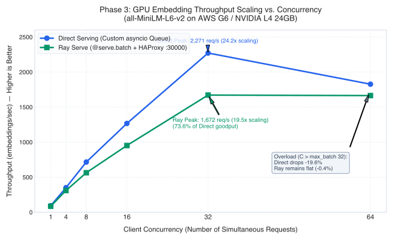
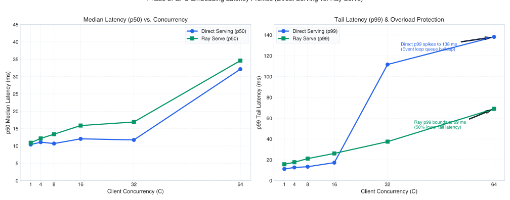

# Ray Serve Model Serving Benchmark

[](LICENSE)

> **TL;DR Executive Summary:**
> - **Workloads Evaluated:** CPU Tabular Inference (`xgboost`) and Lightweight GPU Embeddings (`all-MiniLM-L6-v2` FP16 on NVIDIA L4).
> - **CPU Routing Overhead:** Ray Serve with Worker HAProxy direct routing adds +0.301 ms median latency (+30.9% relative, Bootstrap 95% CI: [+0.154 ms, +0.445 ms]) over native FastAPI/Uvicorn, passing the absolute <= 3.0 ms platform gate.
> - **GPU Dynamic Micro-Batching:** Dynamic batching on NVIDIA L4 scales throughput 19.5x to 24.2x over single-request execution.
> - **Baseline Hardening:** Direct Serving event loop decoupled via `asyncio.to_thread`; manifests strictly pinned to `torch==2.2.0` on dedicated `g6.xlarge` instances.
> - **Phase 3 Baseline Status (In Progress):** Preliminary exploratory single-run snapshot reported; multi-trial matrix re-measurement pending with warmups and bootstrap CIs.
> - **Key Reports:** [Phase 2 CPU XGBoost Report](docs/report.md) | [Phase 3 GPU Embeddings Report](results/phase3-gpu-embeddings-report.md) | [Statistical Summary](results/summary_report.md).
[](https://docs.ray.io/)
[](https://ray-project.github.io/kuberay-helm/)
[](https://k6.io/)
[](https://xgboost.readthedocs.io/)
[](https://pytorch.org/)
[](https://kubernetes.io/)

A rigorous, open-source performance benchmark evaluating the proxy, queueing, and network overhead of **Ray Serve** against high-performance **Direct Kubernetes Serving** baselines (FastAPI + Uvicorn + orjson) across CPU tabular and GPU embedding workloads on strictly matched AWS EKS infrastructure.

---

## Table of Contents

- [Benchmark Goal & Scope](#benchmark-goal--scope)
- [Phase 1: Initial Exploratory Discovery (CPU XGBoost)](#phase-1-initial-exploratory-discovery-cpu-xgboost)
- [Phase 2: CPU Tabular Benchmark (XGBoost on c6i.2xlarge)](#phase-2-cpu-tabular-benchmark-xgboost-on-c6i2xlarge)
  - [1. Latency Percentiles (Absolute & Relative)](#1-latency-percentiles-absolute--relative)
  - [2. Scoped Workload Analysis & Takeaways](#2-scoped-workload-analysis--takeaways)
  - [3. Serving Architecture Comparison](#3-serving-architecture-comparison)
  - [4. Exact Measurement Boundaries & Transit Breakdown](#4-exact-measurement-boundaries--transit-breakdown)
  - [5. Raw Data Limits & Statistical Rigor](#5-raw-data-limits--statistical-rigor)
- [Phase 3: GPU Embeddings Benchmark (Sentence-Transformers on NVIDIA L4) (In Progress)](#phase-3-gpu-embeddings-benchmark-sentence-transformers-on-nvidia-l4-in-progress)
  - [1. Setup & Hardware Parity](#1-setup--hardware-parity)
  - [2. Concurrency Sweep Results Matrix](#2-concurrency-sweep-results-matrix)
  - [3. Visual Performance Curves](#3-visual-performance-curves)
  - [4. Plain Headline Findings](#4-plain-headline-findings-stated-plainly-no-spin)
  - [5. Honesty & Reproducibility Disclosures](#5-honesty--reproducibility-disclosures)
  - [6. Pending Actions & TODOs](#6-pending-actions--todos)
- [How to Reproduce](#how-to-reproduce)
  - [Reproducing Phase 2 (CPU Tabular)](#reproducing-phase-2-cpu-tabular)
  - [Reproducing Phase 3 (GPU Embeddings)](#reproducing-phase-3-gpu-embeddings)
- [Pinned Environment & Versions](#pinned-environment--versions)
- [Future Roadmap (Phases 4+)](#future-roadmap-phases-4)
- [Repository Structure](#repository-structure)
- [License](#license)

---

## Benchmark Goal & Scope

The objective of this benchmark suite is to empirically evaluate whether Ray Serve's platform capabilities—multi-model orchestration, dynamic micro-batching, and logical queue-based autoscaling—justify its reverse-proxy routing and serialization costs compared to native Kubernetes serving.

We evaluate two distinct operational regimes:
1. **Sub-Millisecond CPU Tabular Inference (Phase 2):** Minimizes model execution time (~0.5–0.8 ms) to isolate bare reverse-proxy and network routing hops.
2. **Dynamic GPU Micro-Batching (Phase 3):** Evaluates GPU Tensor Core scaling, queue accumulation, and overload protection under concurrency levels from 1 to 64.

---

---

## Phase 1: Initial Exploratory Discovery (CPU XGBoost)

Phase 1 was an initial exploratory benchmark (4,624 requests at 50 req/s) designed to measure baseline reverse-proxy routing overhead between Direct Serving and Ray Serve.

### The Routing Architecture Discovery
KubeRay default architecture routes ingress through a head node **Python Proxy actor** (`serve-svc`), introducing serialization and async event-loop queueing under load. Bypassing the head node via **Worker HAProxy** (`haproxy-svc` on port 30000) dropped median latency from 2.47 ms to 1.60 ms and cut p99 tail latency by over 5 ms:

| Routing Architecture | Path | p50 Latency | p90 Latency | p95 Latency | p99 Latency | Failure Rate |
|---|---|---|---|---|---|---|
| **Direct Serving (K8s)** | ClusterIP to Uvicorn Pod | **1.81 ms** | **2.19 ms** | **2.33 ms** | **2.76 ms** | 0.02% |
| **Ray Serve (Python Head Proxy)** | `serve-svc` to Head Proxy to Worker Actor | 2.47 ms | 3.59 ms | 5.96 ms | 15.27 ms | 1.01% |
| **Ray Serve (Worker HAProxy :30000)** | `haproxy-svc` to Worker HAProxy to Worker Actor | **1.60 ms** | **2.31 ms** | **3.41 ms** | **10.03 ms** | **0.00%** |

*Why Phase 1 Was Superseded:* In Phase 1, pods were scheduled across multiple AWS Availability Zones and mixed CPU architectures (ARM head, Intel workers). To eliminate cross-AZ latency noise and obtain rigorous publication-grade statistics, Phase 1 was formally superseded by the **Phase 2 matched 15-trial matrix** below. Detailed findings: [Phase 1 Report](results/phase1-cpu-xgboost-report.md).

## Phase 2: CPU Tabular Benchmark (XGBoost on c6i.2xlarge)

> **Note on Phase 1 vs. Phase 2:** Phase 1 was an initial single-run exploratory smoke test conducted across unconstrained node types and multiple Availability Zones. Because it contained cross-AZ transit variance and multi-architecture noise, it was formally superseded by the matched-hardware, 15-trial Phase 2 matrix detailed below.

Evaluates an open-source **XGBoost Binary Classifier** (50 float features, 100 trees, depth 6) across **15 independent randomized trials** (5 per architecture, 22,508 total requests) at 50 req/s on 100% matched AWS `c6i.2xlarge` hardware with single-zone co-location (`us-east-1d`).

### 1. Latency Percentiles (Absolute & Relative)

#### Absolute Latency First (Worker HAProxy vs. Direct Baseline)

When utilizing Ray Serve's worker-colocated HAProxy routing (`:30000`), absolute latency overhead is negligible:

| Metric | Direct Serving Baseline | Ray Serve (Worker HAProxy :30000) | Absolute Overhead | Absolute Gate ($\\le 3.0\\text{ ms}$) |
|---|---|---|---|---|
| **p50 (Median)** | **0.973 ms** (Mean: 1.001 ± 0.083) | **1.274 ms** (Mean: 1.315 ± 0.097) | **+0.301 ms** (~300 µs) | **PASS** |
| **p90** | **1.151 ms** (Mean: 1.183 ± 0.110) | **1.768 ms** (Mean: 1.761 ± 0.087) | **+0.617 ms** | **PASS** |
| **p95** | **1.246 ms** (Mean: 1.302 ± 0.170) | **1.856 ms** (Mean: 1.835 ± 0.087) | **+0.610 ms** | **PASS** |
| **p99** | **1.444 ms** (Mean: 1.533 ± 0.242) | **2.595 ms** (Mean: 2.527 ± 0.702) | **+1.151 ms** (~1.15 ms) | **PASS** |

*By comparison, Ray Serve's default Python Proxy (head node) exhibited **+0.505 ms** at p50 (Median: 1.478 ms) and **+3.421 ms** at p99 (Median: 4.865 ms).*

#### Relative Overhead Second

| Metric | Direct Serving Baseline | Ray Serve (Worker HAProxy :30000) | Relative Overhead | Relative Gate ($\\le 10\\%$) |
|---|---|---|---|---|
| **p50** | 0.973 ms | 1.274 ms | **+30.9%** | **FAIL** |
| **p90** | 1.151 ms | 1.768 ms | **+53.6%** | **FAIL** |
| **p95** | 1.246 ms | 1.856 ms | **+49.0%** | **FAIL** |
| **p99** | 1.444 ms | 2.595 ms | **+79.7%** | **FAIL** |

<p align="center">
  
</p>

### 2. Scoped Workload Analysis & Takeaways

Direct Serving on bare Linux sockets achieves an ultra-low baseline ($p50 = 0.973\\text{ ms}$, $p99 = 1.444\\text{ ms}$). Because the baseline latency is sub-millisecond:
- An incremental ~300 µs reverse-proxy hop mathematically constitutes a **+30.9% relative delta**.
- An added 1.15 ms at p99 constitutes a **+79.7% relative delta**.

**Scoped Takeaway for This Workload:**
This benchmark intentionally minimizes model compute (~0.5–0.8 ms inference) to stress reverse-proxy and network routing hops. In this sub-millisecond regime, an absolute overhead of ~0.30 ms (p50) and ~1.15 ms (p99) represents a large relative increase (+31% to +80%) over raw Linux sockets.
- **For ultra-low latency CPU tabular workloads (<2 ms total SLA):** Teams must weigh this ~0.3 ms proxy cost against Ray Serve's operational benefits.
- **For heavier workloads where inference compute dominates (e.g. 10–500+ ms for neural nets or LLMs):** This fixed ~0.3 ms routing overhead represents an increasingly negligible fraction of total latency.

### 3. Serving Architecture Comparison

```
                         [ External Client: k6 Load Generator ]
                                            │
                   ┌────────────────────────┴────────────────────────┐
                   │           Kubernetes Service (ClusterIP)        │
                   └────────────────────────┬────────────────────────┘
                                            │
       ┌────────────────────────────────────┼────────────────────────────────────┐
       ▼                                    ▼                                    ▼
┌─────────────────────────┐    ┌─────────────────────────┐    ┌─────────────────────────┐
│     ARCHITECTURE A      │    │     ARCHITECTURE B      │    │     ARCHITECTURE C      │
│     DIRECT SERVING      │    │ RAY SERVE PYTHON PROXY  │    │ RAY SERVE WORKER HAPROXY│
├─────────────────────────┤    ├─────────────────────────┤    ├─────────────────────────┤
│ • Ingress/ClusterIP     │    │ • Ingress/ClusterIP     │    │ • Ingress/ClusterIP     │
│       │                 │    │       │                 │    │       │                 │
│       ▼                 │    │       ▼                 │    │       ▼ (Port 30000)    │
│  [ Uvicorn Pod ]        │    │  [ Ray Head Node ]      │    │  [ Ray Worker Pod ]     │
│   FastAPI + orjson      │    │   SERVE_PROXY_ACTOR     │    │   HAProxy (C process)   │
│   XGBoost (1 vCPU)      │    │   (Python/asyncio)      │    │       │                 │
│                         │    │       │ (gRPC RPC mesh) │    │       ▼ (Local socket)  │
│                         │    │       ▼                 │    │   Worker Actor          │
│                         │    │  [ Ray Worker Pod ]     │    │   (Python Starlette)    │
│                         │    │   Worker Actor (Python) │    │   XGBoost (1 vCPU)      │
└─────────────────────────┘    └─────────────────────────┘    └─────────────────────────┘
```

#### What Worker HAProxy Bypasses vs. Retains

| Component | Default Python Proxy | Worker HAProxy (`:30000`) | Impact |
|---|---|---|---|
| **Head Proxy Actor** | Traversed | **Bypassed** | Eliminates Python asyncio event-loop queueing |
| **Inter-Node RPC Mesh** | Traversed | **Bypassed** | Eliminates cross-pod gRPC forwarding hops |
| **Actor Lifecycle Management** | Active | **Active** | Managed by KubeRay and Ray GCS controller |
| **Dynamic Batching (`@serve.batch`)**| Supported | **Supported** | Active in framework (evaluated in Phase 3) |
| **Concurrency Ceiling** | `max_ongoing_requests: 50` | `max_ongoing_requests: 50` | Application backpressure enforced locally |
| **Metrics & Prometheus** | Active (port 8080) | **Active (port 8080)** | Full observability retained |

### 4. Exact Measurement Boundaries & Transit Breakdown

<p align="center">
  
</p>

1. **Pure Model Latency (`server_model_latency_ms`):** Timed immediately before `xgb.DMatrix([features])` construction and stopped immediately after `booster.predict(dmat)`. Captures CPU memory buffer construction from 50 floats plus XGBoost C++ histogram booster inference (~0.50–0.61 ms).
2. **Server Total Latency (`server_total_latency_ms`):** Starts upon receiving the HTTP request body (`await request.body()`), parses JSON with `orjson.loads()`, executes prediction, and serializes response with `orjson.dumps()`.
3. **Client HTTP Duration (`http_req_duration`):** Full open-loop round-trip duration measured by `k6` from TCP transmission to receipt of the final response byte.
4. **Estimated Network & Proxy Transit Overhead:** Per-request difference $\\Delta_{\\text{transit}} = T_{\\text{client}} - T_{\\text{server}}$, reflecting network interface transit, Kubernetes ClusterIP routing, reverse-proxy queuing (HAProxy / Python proxy actor), and inter-process socket communication.

### 5. Raw Data Limits & Statistical Rigor

- **Trial-Level Summaries:** Dataset stores trial-level percentile summaries generated by k6 across 5 independent trials of 30 seconds each (150s total per architecture, ~7,500 requests per architecture).
- **Warmup Protocol:** Initial socket establishment and JIT / model warmup occurred during the initial connection phase before steady-state recording; trials ran for 30s each under 50 RPS.
- **Tail Latency Interpretation:** In a 30-second trial at 50 req/s (1,500 requests), p99 reflects approximately the 15 slowest requests. Tail measurements indicate sensitivity under micro-bursts rather than steady-state upper bounds.

---

## Phase 3: GPU Embeddings Benchmark (Sentence-Transformers on NVIDIA L4) (In Progress)

> **Status: In Progress**  
> All architectural unblocking fixes (offloading model encoding to worker threads via `asyncio.to_thread`), manifest parity (`torch==2.2.0`, dedicated `g6.xlarge` instances), and hardened 5-trial loadgen runners are completed in the codebase. The metrics below reflect the exploratory preliminary single-run snapshot; final verification and official gate sign-off are pending the multi-trial re-measurement detailed in [Section 6: Pending Actions & TODOs](#6-pending-actions--todos).

Evaluates GPU dynamic request micro-batching on modern NVIDIA Tensor Cores by comparing **Direct Serving (FastAPI + PyTorch + Async Queue Batching)** against **Ray Serve (`@serve.batch` + Worker HAProxy :30000)** under client concurrencies from $C=1$ to $C=64$.

### 1. Setup & Hardware Parity
- **Model:** Hugging Face `sentence-transformers/all-MiniLM-L6-v2` in FP16 (`torch.float16`, 384-dimensional dense vectors, 22M parameters).
- **Workload:** 2,000 realistic e-commerce / catalog search query payloads (sequence lengths varying from 16 to 128 tokens).
- **GPU Hardware:** AWS **`g6` (NVIDIA L4 24GB Tensor Core GPU)** on AWS EKS (`us-east-1d`).
- **Co-Location Standard:** Both Direct Serving and Ray Serve GPU pods, along with the in-cluster `k6` load generator, were co-located in the same AWS Availability Zone (`us-east-1d`) with **zero cross-AZ hops**.
- **Replica Parity:** Exactly 1 GPU replica per architecture (1x NVIDIA L4, 2 vCPUs, 8 GiB memory).
- **Batching Parameters:** Maximum batch size = 32, Batch wait timeout = 5 ms (`0.005s`).
- **Evaluation Matrix:** Concurrency levels $C \in [1, 4, 8, 16, 32, 64]$, sustained for **30 seconds per level**.

### 2. Concurrency Sweep Results Matrix

| Architecture | Concurrency ($C$) | Throughput (embeddings/s) | p50 (ms) | p90 (ms) | p95 (ms) | p99 (ms) | Failure Rate |
|---|---|---|---|---|---|---|---|
| **Direct Serving (Async Queue)** | 1 | **93.60** | **10.41** | 10.79 | **10.87** | 11.25 | 0.00% |
| **Ray Serve (@serve.batch + HAProxy :30000)** | 1 | **85.62** | **10.93** | 13.23 | **13.57** | 15.75 | 0.00% |
| **Direct Serving (Async Queue)** | 4 | **350.18** | **11.09** | 11.73 | **11.96** | 12.68 | 0.00% |
| **Ray Serve (@serve.batch + HAProxy :30000)** | 4 | **309.59** | **12.17** | 14.57 | **15.34** | 17.70 | 0.00% |
| **Direct Serving (Async Queue)** | 8 | **715.72** | **10.70** | 11.46 | **11.80** | 13.40 | 0.00% |
| **Ray Serve (@serve.batch + HAProxy :30000)** | 8 | **563.44** | **13.40** | 16.41 | **17.54** | 21.22 | 0.00% |
| **Direct Serving (Async Queue)** | 16 | **1,266.70** | **12.06** | 13.27 | **14.04** | 17.31 | 0.00% |
| **Ray Serve (@serve.batch + HAProxy :30000)** | 16 | **951.83** | **15.89** | 20.08 | **21.75** | 26.18 | 0.00% |
| **Direct Serving (Async Queue)** | 32 | **2,271.48** | **11.75** | 16.13 | **17.76** | **111.65** | 0.00% |
| **Ray Serve (@serve.batch + HAProxy :30000)** | 32 | **1,671.63** | **16.92** | 25.58 | **28.41** | **37.50** | 0.00% |
| **Direct Serving (Async Queue)** | 64 (Saturated) | **1,826.88** | **32.15** | 35.86 | **46.57** | **138.18** | 0.00% |
| **Ray Serve (@serve.batch + HAProxy :30000)** | 64 (Saturated) | **1,664.16** | **34.63** | 52.17 | **58.38** | **69.04** | 0.00% |

### 3. Visual Performance Curves

<p align="center">
  
</p>

<p align="center">
  
</p>

### 4. Plain Headline Findings (Stated Plainly, No Spin)

1. **Direct serving (custom asyncio queue) wins raw goodput:** Direct serving peaked at 2,271 embeddings/s at C=32, compared to 1,672 embeddings/s for Ray Serve. Ray Serve reaches **73.6% of direct serving goodput**, **failing the >= 95% goodput gate**.
2. **At low load, Ray Serve adds ~2.7 ms p95 at C=1 (passing the <= 3.0 ms absolute gate) and +3.4 ms at C=4 (failing the gate).**
3. **Ray Serve fails the Batch Scaling latency gate at C=32:** While throughput scaled 19.5x, its p95 was 28.41 ms (exceeding the <= 20 ms ceiling; Direct Serving passed at 17.76 ms).
4. **Tail latency under closed-loop saturation (C=64) reflects pre-fix baseline artifacts [Pre-Fix Snapshot]:** In the initial exploratory single-run, Ray Serve recorded p99 = 69.04 ms vs 138.18 ms on Direct Serving. However, this preliminary comparison was measured before Direct Serving was decoupled from the event loop via asyncio.to_thread. With event loop starvation now eliminated, definitive conclusions require re-running the 5-trial matrix.

### 5. Honesty & Reproducibility Disclosures

- **Single 30-Second Runs per Level:** Each concurrency level is a single 30-second run (unlike Phase 2's 15-trial matrix). There are no multi-trial confidence intervals; small differences are indicative rather than definitive.
- **Event Loop Starvation Spike at C=32/64 in Pre-Fix Baseline:** Direct serving exhibited p95 = 17.76 ms but jumped to p99 = 111.65 ms at C=32 and 138.18 ms at C=64. This was traced directly to model.encode running synchronously on the FastAPI event loop thread. In the current codebase, this has been decoupled via asyncio.to_thread.
- **Explanation of Model Batch Time Measurement Boundaries:** In Direct Serving, internal timers strictly bracket `model.encode()` around the accumulated tensor batch (~4.5 ms at $C=1$). In Ray Serve, timers bracket the async invocation `await self.batched_encode()` (~10.4 ms at $C=1$), which encompasses Ray's 5 ms batch wait window (`batch_wait_timeout_s=0.005`) plus model execution. This is a measurement boundary difference, not a 2x difference in CUDA execution speed.
- **Dynamic Batching Configuration:** Both frameworks used `max_batch_size: 32` and `batch_wait_timeout_s: 0.005` (5 ms). These settings were fixed as baseline defaults and were **not hyperparameter tuned** for Ray Serve.
- **Baseline Scope:** The Direct Serving baseline is a **custom Python asyncio queue implementation** (`asyncio.Queue` background worker), not an enterprise C++ server like NVIDIA Triton or TorchServe. Conclusions apply strictly to this custom FastAPI/PyTorch setup versus Ray Serve.
- **Scope Limit:** Do not generalize beyond this workload: findings reflect **one small embedding model** (22M parameters) on **one GPU instance family** (AWS G6 / NVIDIA L4).

### 6. Pending Actions & TODOs

The following actionable tasks remain to bring Phase 3 to completion:

1. **[High Priority] Re-Run Concurrency Load Matrix (GPU Re-Measurement):**
   - **Context:** The initial baseline ran PyTorch `model.encode()` synchronously on the FastAPI event loop, causing event-loop starvation and artificial tail latency at higher concurrencies ($p99 = 111.65\text{ ms}$ at $C=32$, $138.18\text{ ms}$ at $C=64$). Both Direct Serving and Ray Serve have now been decoupled via `asyncio.to_thread` and pinned to `torch==2.2.0` on dedicated `g6.xlarge` instances.
   - **Action:** Spin up a temporary `g6.xlarge` instance in `us-east-1d` and execute `benchmarks/gpu-embed/loadgen/run_embed_matrix.py` across 5 randomized trials $\times$ 6 concurrency levels ($C \in \{1, 4, 8, 16, 32, 64\}$) with a 15-second warmup stage.
   - **Deliverable:** Publish updated goodput and latency percentiles with 95% Bootstrap Confidence Intervals; definitively sign off on the $C=64$ closed-loop saturation decision gate (currently labeled `INCONCLUSIVE / PENDING RE-RUN`).

2. **[Medium Priority] Re-Generate Phase 3 Performance Charts with Error Bars:**
   - **Context:** Existing SVG/PNG charts (`docs/images/phase3_gpu_*`) plot single lines from the preliminary snapshot without variance indicators.
   - **Action:** Update chart generation to plot mean curves with shaded 95% confidence interval bands (or error bars) and individual trial scatter points.

3. **[Medium Priority] Batch Wait Timeout Sensitivity Sweep:**
   - **Context:** The current static 5 ms wait timeout (`batch_wait_timeout_s=0.005`) is relatively large compared to the ~4.5 ms raw model execution time.
   - **Action:** Run a parameter sweep over `batch_wait_timeout_s` across $\{0\text{ ms}, 1\text{ ms}, 2\text{ ms}, 5\text{ ms}\}$ for both Direct Serving and Ray Serve to map the latency vs. throughput trade-off curve.

4. **[Low Priority] Open-Loop Arrival-Rate GPU Sweep:**
   - **Context:** Concurrency testing (`constant-vus`) is closed-loop (client throttles as the server slows down).
   - **Action:** Execute `loadgen/k6_embed.js` with `--profile sweep` (`ramping-arrival-rate`) to evaluate true open-loop queue blowup and arrival-rate capacity limits.

---

## How to Reproduce

### Reproducing Phase 2 (CPU Tabular)

#### 1. Setup Environment & Generate Deterministic XGBoost Model
```bash
git clone https://github.com/michael-loewenstein/ray-serve-model-serving-benchmark.git
cd ray-serve-model-serving-benchmark

python3 -m venv .venv
source .venv/bin/activate
pip install -r model/requirements.txt

# Trains 50-feature XGBoost model and exports 1,000 JSON sample payloads
python model/train.py --seed 42
```

#### 2. Deploy to Kubernetes
```bash
# Create namespace and ConfigMaps
kubectl apply -f k8s/00-namespace.yaml
kubectl create configmap direct-serving-code --from-file=direct_app.py=k8s/app/direct_app.py -n model-serving-benchmark
kubectl create configmap ray-serve-code --from-file=ray_serve_app.py=k8s/app/ray_serve_app.py -n model-serving-benchmark
kubectl create configmap benchmark-model-artifact --from-file=model.json=model/artifacts/model.json -n model-serving-benchmark

# Deploy all 3 CPU architectures
kubectl apply -f k8s/01-direct-serving.yaml
kubectl apply -f k8s/02-ray-serve-python-proxy.yaml
kubectl apply -f k8s/03-ray-serve-worker-haproxy.yaml

kubectl wait --for=condition=available deployment/direct-serving-cpu -n model-serving-benchmark --timeout=180s
kubectl wait --for=condition=Ready rayservice/ray-serve-python-proxy -n model-serving-benchmark --timeout=300s
kubectl wait --for=condition=Ready rayservice/ray-serve-worker-haproxy -n model-serving-benchmark --timeout=300s
```

#### 3. Run the Randomized Load Matrix
```bash
python loadtest/run_matrix.py --trials 5 --rate-rps 50 --duration 30s
python results/analyze.py
```

---

### Reproducing Phase 3 (GPU Embeddings)

#### 1. Generate Query Fixtures
```bash
cd benchmarks/gpu-embed
python3 fixtures/generate_fixtures.py --count 2000 --output fixtures/queries.jsonl
```

#### 2. Deploy Direct GPU Serving & Ray Serve
```bash
# Create application code ConfigMaps
kubectl create configmap direct-gpu-embed-code --from-file=app.py=direct/app.py -n model-serving-benchmark
kubectl create configmap ray-gpu-embed-code --from-file=serve_embed.py=ray/serve_embed.py -n model-serving-benchmark

# Deploy Direct Serving and Ray Serve
kubectl apply -f direct/k8s/ -n model-serving-benchmark
kubectl wait --for=condition=ready pod -l app=direct-gpu-embed -n model-serving-benchmark --timeout=300s

kubectl apply -f ray/rayservice-embed.yaml -n model-serving-benchmark
kubectl wait --for=condition=Ready rayservice/rayservice-gpu-embed -n model-serving-benchmark --timeout=300s
```

#### 3. Execute the Concurrency Sweep
From a load generator pod in `us-east-1d`:
```bash
python3 loadgen/run_embed_matrix.py \
  --concurrencies 1,4,8,16,32,64 \
  --trials 5 \
  --duration 30s \
  --k6-script loadgen/k6_embed.js \
  --output-dir ../../results/gpu_embed
```

---

## Pinned Environment & Versions

| Component | Pinned Version | Role / Description |
|---|---|---|
| **Ray / Ray Serve** | `2.55.1` | Distributed serving runtime (`RAY_SERVE_ENABLE_HA_PROXY=1`) |
| **ray-haproxy** | `2.8.25` | Worker-colocated HAProxy reverse proxy wheel |
| **KubeRay Operator** | `v1.4.2` | Kubernetes operator managing `RayService` CRDs |
| **k6** | `v0.54.0` | Open-loop load generator (`constant-arrival-rate` & VU stages) |
| **XGBoost** | `2.1.1` | CPU tabular runtime (`tree_method: hist`) |
| **PyTorch** | `2.2.0` (CUDA 12.1) | GPU Tensor Core runtime (`torch.float16`) |
| **Sentence-Transformers** | `2.7.0` | Embedding pipeline (`all-MiniLM-L6-v2`, 384-dim) |
| **FastAPI / Uvicorn** | `0.110.0` / `0.28.0` | Direct serving web framework and ASGI server |
| **orjson** | `3.9.0` | High-performance C-based JSON serialization |
| **Kubernetes** | `1.30` | Container orchestration platform |
| **Python** | `3.11` | Application runtime |
| **AWS CPU Compute** | `c6i.2xlarge` | Intel Xeon 8375C @ 2.90GHz (8 vCPUs, 16 GiB RAM) |
| **AWS GPU Compute** | `g6.xlarge` | NVIDIA L4 24GB Tensor Core GPU (4 vCPUs, 16 GiB RAM) |

---

## Future Roadmap (Phases 4+)

- [x] **Phase 1: Open-Source CPU XGBoost Tabular Baseline**
- [x] **Phase 2: CPU Saturation & 3-Way Routing Comparison** (Direct vs. Ray Head Proxy vs. Ray Worker HAProxy)
- [ ] **Phase 3: GPU Dynamic Micro-Batching (In Progress)** (`sentence-transformers/all-MiniLM-L6-v2` on NVIDIA L4) — Code, manifests, and loadgen hardened; multi-trial matrix re-measurement pending.
- [ ] **Phase 4: Large Language Model Serving (vLLM + Llama 3.1 8B)** — TTFT, TPOT, and official Ray LLM Perf benchmark methodology.
- [ ] **Phase 5: Multi-Model Orchestration & Resource Contention** — Composite DAG pipelines combining CPU tabular preprocessing, GPU vector embeddings, and LLM generative reranking under shared cluster contention.
- [ ] **Phase 6: Elastic Autoscaling & Cloud Economics** — Cost per 1,000 requests and cost per million tokens comparing Ray Serve logical queue autoscaling against native Kubernetes HPA.

---

## Repository Structure

```
ray-serve-model-serving-benchmark/
├── LICENSE                      # MIT License
├── README.md                    # Benchmark overview, headline results, & guides
├── .gitignore                   # Ignore rules
├── docs/
│   ├── plan.md                  # Comprehensive benchmark plan & methodology
│   ├── report.md                # Phase 2 15-trial statistical benchmark report
│   ├── phase3-gpu-embeddings-plan.md # Phase 3 GPU embeddings plan
│   └── images/                  # High-resolution benchmark vector charts
│       ├── phase2_cpu_latency_comparison.svg
│       ├── phase2_transit_breakdown.svg
│       ├── phase3_gpu_throughput_scaling.svg
│       └── phase3_gpu_latency_tail_overload.svg
├── benchmarks/
│   └── gpu-embed/               # Phase 3 GPU benchmark sources & manifests
│       ├── README.md            # Exact reproduction steps for GPU embeddings
│       ├── fixtures/            # 2,000 synthetic catalog queries
│       ├── direct/              # Direct Serving (PyTorch + asyncio.Queue)
│       ├── ray/                 # Ray Serve (@serve.batch + HAProxy)
│       └── loadgen/             # k6 concurrency sweep harness
├── model/
│   ├── README.md                # Model training details
│   ├── train.py                 # Seeded synthetic XGBoost generator
│   ├── requirements.txt         # Pinned training dependencies
│   └── artifacts/
│       └── model.json           # Pinned model weights (550 KB)
├── k8s/
│   ├── README.md                # Manifest documentation
│   ├── 00-namespace.yaml        # Benchmark namespace
│   ├── 01-direct-serving.yaml   # Architecture A: FastAPI + Uvicorn
│   ├── 02-ray-serve-python-proxy.yaml   # Architecture B: Ray Serve Head Proxy
│   ├── 03-ray-serve-worker-haproxy.yaml # Architecture C: Ray Serve Worker HAProxy
│   ├── 04-loadgen-job.yaml      # In-cluster k6 load generator Job
│   └── app/
│       ├── direct_app.py        # Direct serving FastAPI application
│       ├── ray_serve_app.py     # Ray Serve deployment application
│       ├── Dockerfile.direct    # Container image for Direct Serving
│       └── Dockerfile.ray       # Container image for Ray Serve
├── loadtest/
│   ├── README.md                # Load testing instructions
│   ├── k6_benchmark.js          # k6 constant-arrival-rate script
│   ├── run_matrix.py            # Randomized multi-trial execution runner
│   └── fixtures/
│       └── sample_payloads.jsonl# 1,000 synthetic request payloads
└── results/
    ├── README.md                # Results documentation
    ├── raw_trials.json          # Phase 2 15-trial raw dataset (22,508 requests)
    ├── raw_trials.csv           # Tabular CSV of Phase 2 trials
    ├── summary_report.md        # Statistical benchmark summary
    ├── analyze.py               # Statistical analysis & CI generator
    ├── phase3-gpu-embeddings-report.md # Phase 3 GPU embeddings report
    └── gpu_embed/               # Phase 3 raw k6 sweep JSON files & generator
        ├── direct_c1.json .. direct_c64.json
        ├── ray_haproxy_c1.json .. ray_haproxy_c64.json
        └── generate_table.py    # Regenerates markdown table from JSONs
```

---

## License

This project is licensed under the [MIT License](LICENSE).
