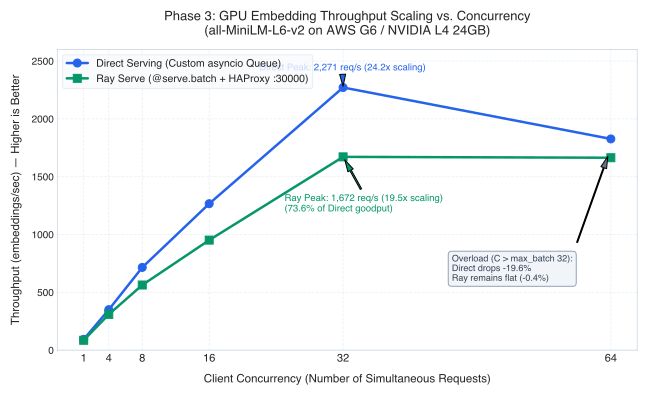
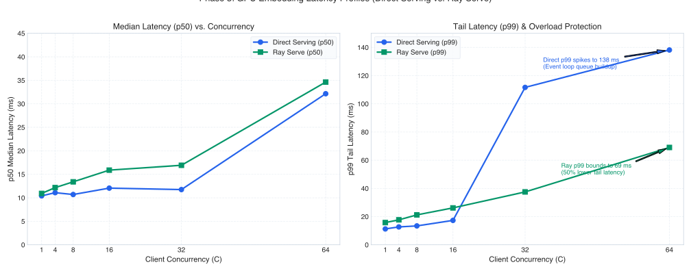

# Ray Serve Model Serving Benchmark

[](LICENSE)

> **TL;DR Executive Summary:**
> - **Workloads Evaluated:** CPU Tabular Inference (`xgboost`) and Lightweight GPU Embeddings (`all-MiniLM-L6-v2` FP16 on NVIDIA L4).
> - **CPU Routing Overhead (Phase 2, Ray 2.60.0, 31 trials, 0 failures):** against block-matched FastAPI/Uvicorn baselines, Ray Serve's HAProxy ingress on `:8000` (verified live in the request path) adds +0.314 ms p50 / +0.550 ms p99, and direct ingress on `:30000` adds +0.138 ms p50 / +0.137 ms p99. Both pass the absolute <= 3.0 ms gate. The default Python proxy adds +3.517 ms p50 / +4.484 ms p99 and fails it. No Ray arm passes the 10% relative gate at a ~1.1 ms baseline. See the [Phase 2 Report](results/phase2-rerun-2026-11-18-report.md).
> - **GPU Dynamic Micro-Batching:** Dynamic batching on NVIDIA L4 scales throughput 19.5x to 24.2x over single-request execution.
> - **Baseline Hardening:** Serving event loops decoupled via `asyncio.to_thread`; manifests pinned to `torch==2.2.0` on `g6.xlarge` instances (instance type and zone pinned, but not node-isolated).
> - **Phase 3 Baseline Status (In Progress):** Preliminary exploratory single-run snapshot reported; multi-trial matrix re-measurement pending with warmups and bootstrap CIs.
> - **Key Reports:** [Phase 2 CPU Rerun Report](results/phase2-rerun-2026-11-18-report.md) | [Phase 2 Statistical Summary](results/phase2-rerun-2026-11-18/summary_report.md) | [Phase 3 GPU Embeddings Report](results/phase3-gpu-embeddings-report.md).
[](https://docs.ray.io/)
[](https://ray-project.github.io/kuberay-helm/)
[](https://k6.io/)
[](https://xgboost.readthedocs.io/)
[](https://pytorch.org/)
[](https://kubernetes.io/)

A rigorous, open-source performance benchmark evaluating the proxy, queueing, and network overhead of **Ray Serve** against high-performance **Direct Kubernetes Serving** baselines (FastAPI + Uvicorn + orjson) across CPU tabular and GPU embedding workloads on strictly matched AWS EKS infrastructure.

---

## Table of Contents

- [Benchmark Goal & Scope](#benchmark-goal--scope)
- [Cluster Topology & Request Path](#cluster-topology--request-path)
- [Phase 2: CPU Tabular Benchmark (XGBoost on c6i.2xlarge)](#phase-2-cpu-tabular-benchmark-xgboost-on-c6i2xlarge)
  - [1. Setup & Configuration Proof](#1-setup--configuration-proof)
  - [2. Serving Overhead vs Block-Matched Baselines](#2-serving-overhead-vs-block-matched-baselines)
  - [3. HAProxy-Only Control](#3-haproxy-only-control)
  - [4. Per-Arm Summary & Transit](#4-per-arm-summary--transit)
  - [5. Attributing the HAProxy Arm](#5-attributing-the-haproxy-arm)
  - [6. Limitations & Disclosures](#6-limitations--disclosures)
- [Phase 3: GPU Embeddings Benchmark (Sentence-Transformers on NVIDIA L4) (In Progress)](#phase-3-gpu-embeddings-benchmark-sentence-transformers-on-nvidia-l4-in-progress)
  - [1. Setup & Hardware Parity](#1-setup--hardware-parity)
  - [2. Concurrency Sweep Results Matrix](#2-concurrency-sweep-results-matrix)
  - [3. Visual Performance Curves](#3-visual-performance-curves)
  - [4. Plain Headline Findings](#4-plain-headline-findings-stated-plainly-no-spin)
  - [5. Honesty & Reproducibility Disclosures](#5-honesty--reproducibility-disclosures)
  - [6. Pending Actions & TODOs](#6-pending-actions--todos)
- [How to Reproduce](#how-to-reproduce)
  - [Reproducing Phase 2 (CPU Tabular)](#reproducing-phase-2-cpu-tabular)
  - [Reproducing Phase 3 (GPU Embeddings)](#reproducing-phase-3-gpu-embeddings)
- [Pinned Environment & Versions](#pinned-environment--versions)
- [Future Roadmap (Phases 4+)](#future-roadmap-phases-4)
- [Repository Structure](#repository-structure)
- [License](#license)

---

## Benchmark Goal & Scope

The objective of this benchmark suite is to empirically evaluate whether Ray Serve's platform capabilities—multi-model orchestration, dynamic micro-batching, and logical queue-based autoscaling—justify its reverse-proxy routing and serialization costs compared to native Kubernetes serving.

We evaluate two distinct operational regimes:
1. **Sub-Millisecond CPU Tabular Inference (Phase 2):** Minimizes model execution time (~0.5–0.8 ms) to isolate bare reverse-proxy and network routing hops.
2. **Dynamic GPU Micro-Batching (Phase 3):** Evaluates GPU Tensor Core scaling, queue accumulation, and overload protection under concurrency levels from 1 to 64.

---

## Cluster Topology & Request Path

Full provenance, port citations, and capture commands: [docs/topology-and-request-path.md](docs/topology-and-request-path.md).

```
us-west-2a (single AZ)
┌────────────────────────────────────────────────────────────────────────┐
│ head-1       c6i.2xlarge   bench-role=head                            │
│              KubeRay operator, Ray head (one RayService at a time)    │
│                                                                       │
│ worker-w1    c6i.2xlarge   bench-role=worker  bench-slot=w1            │
│ worker-w2    c6i.2xlarge   bench-role=worker  bench-slot=w2           │
│              one server pod per node (anti-affinity)                  │
│                                                                       │
│ loadgen-1    c6i.2xlarge   bench-role=loadgen                         │
│              k6 driver only                                           │
└────────────────────────────────────────────────────────────────────────┘
```

Blocks are measured one deployment at a time: Block 1 (Direct + HAProxy RayService) measures the Direct, HAProxy `:8000`, and direct-ingress `:30000` arms; Block 2 (Direct + Python-proxy RayService) measures Direct and the Python proxy; Block 3 is a single-replica local control.

**Port roles (Ray 2.60.0):** `:8000` is the Ray Serve HTTP ingress — HAProxy when `RAY_SERVE_ENABLE_HA_PROXY=1`, otherwise the Python proxy. `:30000–31000` is the direct-ingress HTTP server inside each ingress-deployment replica.

**Request paths:**

- **Direct:** k6 pod → ClusterIP `:8000` → Uvicorn pod → FastAPI → model → response.
- **Ray default Python proxy:** k6 pod → `ray-python-proxy-svc :8000` → per-pod Python proxy → Ray actor RPC → replica.
- **Ray HAProxy:** k6 pod → `ray-haproxy-svc :8000` → **HAProxy `:8000`** → replica's direct-ingress server (`:300xx`, leastconn across replicas).
- **Ray direct ingress:** k6 pod → `ray-direct-ingress-svc :8000` → **targetPort 30000** → replica's own HTTP server (no proxy, no HAProxy).

ClusterIP balances per TCP connection, and k6 uses keep-alive, so each VU stays pinned to one backend for the life of its connection.

---

## Phase 2: CPU Tabular Benchmark (XGBoost on c6i.2xlarge)

Evaluates an open-source **XGBoost Binary Classifier** (50 float features, 100 trees, depth 6) at 50 req/s over **31 trials in 3 blocks** (46,519 requests, 0.00% failures) with 15 s unrecorded warmups per arm. Full statistics: [Phase 2 Report](results/phase2-rerun-2026-11-18-report.md), [Statistical Summary](results/phase2-rerun-2026-11-18/summary_report.md). Raw data and per-block run logs are committed under `results/phase2-rerun-2026-11-18/`.

### 1. Setup & Configuration Proof

- **Stack:** Ray **2.60.0** / KubeRay **1.7.2** / EKS **1.34**, 4 × `c6i.2xlarge` pinned to a single AZ (`us-west-2a`), worker `rayStartParams num-cpus: "1"` so replicas spread one-per-worker.
- **Serve config:** `RAY_SERVE_ENABLE_HA_PROXY=1` + `RAY_SERVE_THROUGHPUT_OPTIMIZED=1`, `max_ongoing_requests: 1000`, `proxy_location: EveryNode`, 2 replicas (1 in the local control).
- **HAProxy verified in the path, not assumed:** preflight gates committed as evidence — 3 HAProxyManager actors (head + both replica-hosting workers), one replica per worker each binding `:30000`, HAProxy request counters rising across the gate's requests (352 → 374), 10/10 inferences through each arm, and live pod env showing `RAY_SERVE_ENABLE_HA_PROXY=1` / `RAY_SERVE_THROUGHPUT_OPTIMIZED=1`.

### 2. Serving Overhead vs Block-Matched Baselines

Each Ray arm is compared with the Direct Serving (Uvicorn) trials of the **same block** (median deltas, seeded bootstrap 95% CIs):

| Arm | Metric | Direct baseline | Arm | Delta [95% CI] | Relative | Abs gate ≤ 3.0 ms | Rel gate ≤ 10% |
|---|---|---|---|---|---|---|---|
| **Ray Serve (Direct Ingress :30000)** | p50 | 1.074 ms | 1.212 ms | **+0.138 ms** [+0.031, +0.232] | +12.8% | PASS | FAIL |
| | p95 | 1.322 ms | 1.419 ms | +0.097 ms [+0.052, +0.119] | +7.3% | PASS | PASS |
| | p99 | 1.478 ms | 1.615 ms | **+0.137 ms** [+0.085, +0.187] | +9.3% | PASS | PASS |
| **Ray Serve (HAProxy :8000)** | p50 | 1.074 ms | 1.388 ms | **+0.314 ms** [+0.219, +0.408] | +29.2% | PASS | FAIL |
| | p95 | 1.322 ms | 1.845 ms | **+0.523 ms** [+0.478, +0.570] | +39.6% | PASS | FAIL |
| | p99 | 1.478 ms | 2.028 ms | **+0.550 ms** [+0.473, +0.623] | +37.2% | PASS | FAIL |
| **Ray Serve (Default Python Proxy :8000)** | p50 | 1.138 ms | 4.655 ms | **+3.517 ms** [+2.969, +3.983] | +309.1% | **FAIL** | FAIL |
| | p95 | 1.342 ms | 5.752 ms | **+4.410 ms** [+4.321, +4.540] | +328.6% | **FAIL** | FAIL |
| | p99 | 1.579 ms | 6.063 ms | **+4.484 ms** [+4.396, +4.778] | +284.0% | **FAIL** | FAIL |

**Reading the gates:**

- **HAProxy and direct ingress pass the 3.0 ms absolute gate** on every percentile. At a ~1.1 ms baseline they fail the 10% relative gate — at this scale a fraction of a millisecond is a double-digit percentage.
- **The default Python proxy is the expensive component**, roughly ten times HAProxy: failing even the absolute gate (~+3.5 ms at p50). Prefer HAProxy ingress (`RAY_SERVE_ENABLE_HA_PROXY=1`) when serving latency matters.
- Goodput held at the 50 req/s offer on every arm (per-arm medians 50.00–50.03 req/s, 0.00% failures).

### 3. HAProxy-Only Control

A single-replica local pair (both arms served from the same worker, cross-node balancing removed from the comparison) measures the HAProxy process's own cost:

| Metric | Direct ingress local (median) | HAProxy local (median) | Delta [95% CI] |
|---|---|---|---|
| **p50** | 1.271 ms | 1.412 ms | **+0.141 ms** [+0.118, +0.159] |
| **p95** | 1.477 ms | 1.589 ms | **+0.112 ms** [+0.069, +0.147] |
| **p99** | 1.779 ms | 1.810 ms | +0.031 ms [-0.033, +0.124] — CI crosses zero |

Diagnostic only (n=3 per arm, sequential sub-blocks, 1 replica); not part of the headline gate table.

### 4. Per-Arm Summary & Transit

Medians over each arm's trials (n=10 Direct pooled across blocks; n=5 per Ray arm; see the [summary](results/phase2-rerun-2026-11-18/summary_report.md) for IQRs, t-CIs, and all 31 individual trials):

| Arm | Goodput (req/s) | p50 (ms) | p95 (ms) | p99 (ms) | Transit (p50) |
|---|---|---|---|---|---|
| **Direct Serving (Uvicorn)** | 50.03 | **1.131** | **1.333** | **1.513** | 0.555 ms |
| **Ray Serve (Direct Ingress :30000)** | 50.03 | **1.212** | **1.419** | **1.615** | 0.680 ms |
| **Ray Serve (HAProxy :8000)** | 50.03 | **1.388** | **1.845** | **2.028** | 0.877 ms |
| **Ray Serve (Default Python Proxy :8000)** | 50.03 | **4.655** | **5.752** | **6.063** | 2.774 ms |

### 5. Attributing the HAProxy Arm

Two subtractions locate the parts (indicative; derived from cross-block summary medians):

- **Ray Serve (HAProxy `:8000`) vs Direct (Uvicorn): +0.314 ms p50** — the full cost of putting Ray Serve with HAProxy ingress in the path.
- **HAProxy arm minus direct-ingress arm (both Ray arms; +0.176 ms p50 / +0.426 ms p95 / +0.413 ms p99)** — the HAProxy ingress plus cross-node balancing on top of Ray Serve's replica stack. The **share depends on the percentile**: at the median, HAProxy itself is most of this difference (about 80%; about 45% of the full `:8000` delta), while in the tail cross-node balancing dominates (HAProxy is about 26% at p95 and about 8% at p99).

### 6. Limitations & Disclosures

- 31 short trials (30 s each; 5 per arm, 3 for the control) at a single 50 req/s rate; CIs are percentile bootstraps on those n.
- The local control has no same-block Direct baseline, ran 1 replica vs 2 in Block 1, and its two arms ran as **sequential sub-blocks**, so time drift is not separated from the HAProxy effect. The subtraction mixes blocks and is labeled indicative rather than measured.
- Ray workers got 2 vCPU vs Direct's 1 vCPU (deliberate: raylet + HAProxy + actor vs model-only); disclosed asymmetry, not a hidden advantage.
- The Python-proxy arm sets `RAY_SERVE_ENABLE_DIRECT_INGRESS=0` — the one deviation from the throughput bundle, required to keep per-node Python proxies comparable to the HAProxy arm.
- Direct and Ray worker pods share the two worker nodes; Direct's baseline drifted between blocks (server_total +0.11 ms block1→block2); the Python proxy routes to a local replica by default while HAProxy balances across nodes; only the Ray app records a `Histogram.observe` in the request path.
- Timer boundaries are aligned across Direct and Ray (`t0` before body read; total excludes response serialization). Arm B's server-side total includes the proxy-to-replica transfer, so its transit column understates the proxy cost.
- Scope: one small XGBoost model on one instance family at one load point. Do not generalize to heavier workloads where compute dominates.
- Trial seeds (42/43/44) and each block's execution order are recorded in the report and in `results/phase2-rerun-2026-11-18/run-logs/`. Per-trial timestamps and pod-to-node mapping for the measured deployments were not captured.

---

## Phase 3: GPU Embeddings Benchmark (Sentence-Transformers on NVIDIA L4) (In Progress)

> **Status: In Progress**  
> All architectural unblocking fixes (offloading model encoding to worker threads via `asyncio.to_thread`), manifest parity (`torch==2.2.0`, pinned `g6.xlarge` instances), and hardened 5-trial loadgen runners are completed in the codebase. The metrics below reflect the exploratory preliminary single-run snapshot; final verification and official gate sign-off are pending the multi-trial re-measurement detailed in [Section 6: Pending Actions & TODOs](#6-pending-actions--todos).

Evaluates GPU dynamic request micro-batching on modern NVIDIA Tensor Cores by comparing **Direct Serving (FastAPI + PyTorch + Async Queue Batching)** against **Ray Serve (`@serve.batch` + Direct Ingress :30000)** under client concurrencies from $C=1$ to $C=64$.

### 1. Setup & Hardware Parity
- **Model:** Hugging Face `sentence-transformers/all-MiniLM-L6-v2` in FP16 (`torch.float16`, 384-dimensional dense vectors, 22M parameters).
- **Workload:** 2,000 realistic e-commerce / catalog search query payloads (sequence lengths varying from 16 to 128 tokens).
- **GPU Hardware:** AWS **`g6` (NVIDIA L4 24GB Tensor Core GPU)** on AWS EKS (`us-east-1d`).
- **Co-Location Standard:** Both Direct Serving and Ray Serve GPU pods, along with the in-cluster `k6` load generator, were co-located in the same AWS Availability Zone (`us-east-1d`) with **zero cross-AZ hops**.
- **Replica Parity:** Exactly 1 GPU replica per architecture (1x NVIDIA L4, 2 vCPUs, 8 GiB memory).
- **Batching Parameters:** Maximum batch size = 32, Batch wait timeout = 5 ms (`0.005s`).
- **Evaluation Matrix:** Concurrency levels $C \in [1, 4, 8, 16, 32, 64]$, sustained for **30 seconds per level**.

### 2. Concurrency Sweep Results Matrix

| Architecture | Concurrency ($C$) | Throughput (embeddings/s) | p50 (ms) | p90 (ms) | p95 (ms) | p99 (ms) | Failure Rate |
|---|---|---|---|---|---|---|---|
| **Direct Serving (Async Queue)** | 1 | **93.60** | **10.41** | 10.79 | **10.87** | 11.25 | 0.00% |
| **Ray Serve (@serve.batch + Direct Ingress :30000)** | 1 | **85.62** | **10.93** | 13.23 | **13.57** | 15.75 | 0.00% |
| **Direct Serving (Async Queue)** | 4 | **350.18** | **11.09** | 11.73 | **11.96** | 12.68 | 0.00% |
| **Ray Serve (@serve.batch + Direct Ingress :30000)** | 4 | **309.59** | **12.17** | 14.57 | **15.34** | 17.70 | 0.00% |
| **Direct Serving (Async Queue)** | 8 | **715.72** | **10.70** | 11.46 | **11.80** | 13.40 | 0.00% |
| **Ray Serve (@serve.batch + Direct Ingress :30000)** | 8 | **563.44** | **13.40** | 16.41 | **17.54** | 21.22 | 0.00% |
| **Direct Serving (Async Queue)** | 16 | **1,266.70** | **12.06** | 13.27 | **14.04** | 17.31 | 0.00% |
| **Ray Serve (@serve.batch + Direct Ingress :30000)** | 16 | **951.83** | **15.89** | 20.08 | **21.75** | 26.18 | 0.00% |
| **Direct Serving (Async Queue)** | 32 | **2,271.48** | **11.75** | 16.13 | **17.76** | **111.65** | 0.00% |
| **Ray Serve (@serve.batch + Direct Ingress :30000)** | 32 | **1,671.63** | **16.92** | 25.58 | **28.41** | **37.50** | 0.00% |
| **Direct Serving (Async Queue)** | 64 (Saturated) | **1,826.88** | **32.15** | 35.86 | **46.57** | **138.18** | 0.00% |
| **Ray Serve (@serve.batch + Direct Ingress :30000)** | 64 (Saturated) | **1,664.16** | **34.63** | 52.17 | **58.38** | **69.04** | 0.00% |

### 3. Visual Performance Curves

<p align="center">
  
</p>

<p align="center">
  
</p>

*Phase 3 chart legends retain a legacy "HAProxy :30000" label; read it as "Direct Ingress (`:30000`)". Chart regeneration with corrected labels and error bars is tracked in Section 6.*

### 4. Plain Headline Findings (Stated Plainly, No Spin)

1. **Direct serving (custom asyncio queue) wins raw goodput:** Direct serving peaked at 2,271 embeddings/s at C=32, compared to 1,672 embeddings/s for Ray Serve. Ray Serve reaches **73.6% of direct serving goodput**, **failing the >= 95% goodput gate**.
2. **At low load, Ray Serve adds ~2.7 ms p95 at C=1 (passing the <= 3.0 ms absolute gate) and +3.4 ms at C=4 (failing the gate).**
3. **Ray Serve fails the Batch Scaling latency gate at C=32:** While throughput scaled 19.5x, its p95 was 28.41 ms (exceeding the <= 20 ms ceiling; Direct Serving passed at 17.76 ms).
4. **Tail latency under closed-loop saturation (C=64) reflects pre-fix baseline artifacts [Pre-Fix Snapshot]:** In the initial exploratory single-run, Ray Serve recorded p99 = 69.04 ms vs 138.18 ms on Direct Serving. However, this preliminary comparison was measured before Direct Serving was decoupled from the event loop via asyncio.to_thread. With event loop starvation now eliminated, definitive conclusions require re-running the 5-trial matrix.

### 5. Honesty & Reproducibility Disclosures

- **Single 30-Second Runs per Level:** Each concurrency level is a single 30-second run. There are no multi-trial confidence intervals; small differences are indicative rather than definitive.
- **Event Loop Starvation Spike at C=32/64 in Pre-Fix Baseline:** Direct serving exhibited p95 = 17.76 ms but jumped to p99 = 111.65 ms at C=32 and 138.18 ms at C=64. This was traced directly to model.encode running synchronously on the FastAPI event loop thread. In the current codebase, this has been decoupled via asyncio.to_thread.
- **Explanation of Model Batch Time Measurement Boundaries:** In Direct Serving, internal timers strictly bracket `model.encode()` around the accumulated tensor batch (~4.5 ms at $C=1$). In Ray Serve, timers bracket the async invocation `await self.batched_encode()` (~10.4 ms at $C=1$), which encompasses Ray's 5 ms batch wait window (`batch_wait_timeout_s=0.005`) plus model execution. This is a measurement boundary difference, not a 2x difference in CUDA execution speed.
- **Dynamic Batching Configuration:** Both frameworks used `max_batch_size: 32` and `batch_wait_timeout_s: 0.005` (5 ms). These settings were fixed as baseline defaults and were **not hyperparameter tuned** for Ray Serve.
- **Baseline Scope:** The Direct Serving baseline is a **custom Python asyncio queue implementation** (`asyncio.Queue` background worker), not an enterprise C++ server like NVIDIA Triton or TorchServe. Conclusions apply strictly to this custom FastAPI/PyTorch setup versus Ray Serve.
- **Scope Limit:** Do not generalize beyond this workload: findings reflect **one small embedding model** (22M parameters) on **one GPU instance family** (AWS G6 / NVIDIA L4).

### 6. Pending Actions & TODOs

The following actionable tasks remain to bring Phase 3 to completion:

1. **[High Priority] Re-Run Concurrency Load Matrix (GPU Re-Measurement):**
   - **Context:** The initial baseline ran PyTorch `model.encode()` synchronously on the FastAPI event loop, causing event-loop starvation and artificial tail latency at higher concurrencies ($p99 = 111.65\text{ ms}$ at $C=32$, $138.18\text{ ms}$ at $C=64$). Both Direct Serving and Ray Serve have now been decoupled via `asyncio.to_thread` and pinned to `torch==2.2.0` on `g6.xlarge` instances (instance type and zone pinned; nodes not isolated).
   - **Action:** Spin up a temporary `g6.xlarge` instance in `us-east-1d` and execute `benchmarks/gpu-embed/loadgen/run_embed_matrix.py` across 5 randomized trials $\times$ 6 concurrency levels ($C \in \{1, 4, 8, 16, 32, 64\}$) with a 15-second warmup stage.
   - **Deliverable:** Publish updated goodput and latency percentiles with 95% Bootstrap Confidence Intervals; definitively sign off on the $C=64$ closed-loop saturation decision gate (currently labeled `INCONCLUSIVE / PENDING RE-RUN`).

2. **[Medium Priority] Re-Generate Phase 3 Performance Charts with Error Bars:**
   - **Context:** Existing SVG/PNG charts (`docs/images/phase3_gpu_*`) plot single lines from the preliminary snapshot without variance indicators.
   - **Action:** Update chart generation to plot mean curves with shaded 95% confidence interval bands (or error bars) and individual trial scatter points.

3. **[Medium Priority] Batch Wait Timeout Sensitivity Sweep:**
   - **Context:** The current static 5 ms wait timeout (`batch_wait_timeout_s=0.005`) is relatively large compared to the ~4.5 ms raw model execution time.
   - **Action:** Run a parameter sweep over `batch_wait_timeout_s` across $\{0\text{ ms}, 1\text{ ms}, 2\text{ ms}, 5\text{ ms}\}$ for both Direct Serving and Ray Serve to map the latency vs. throughput trade-off curve.

4. **[Low Priority] Open-Loop Arrival-Rate GPU Sweep:**
   - **Context:** Concurrency testing (`constant-vus`) is closed-loop (client throttles as the server slows down).
   - **Action:** Execute `loadgen/k6_embed.js` with `--profile sweep` (`ramping-arrival-rate`) to evaluate true open-loop queue blowup and arrival-rate capacity limits.

---

## How to Reproduce

### Reproducing Phase 2 (CPU Tabular)

#### 1. Create the cluster and install KubeRay

```bash
python3 -m venv .venv && source .venv/bin/activate
pip install -r model/requirements.txt -r requirements-dev.txt
python model/train.py --seed 42   # trains the 50-feature XGBoost model + 1,000 sample payloads

export AWS_PROFILE=<aws-profile>  # requires EKS/EC2/IAM permissions
eksctl create cluster -f infra/phase2-rerun/eksctl-cluster.yaml --timeout 40m
aws eks update-kubeconfig --name ray-serve-phase2-rerun --region us-west-2 --profile "$AWS_PROFILE" --kubeconfig ~/.kube/ray-serve-phase2-rerun
helm repo add kuberay https://ray-project.github.io/kuberay-helm/ && helm repo update
helm install kuberay-operator kuberay/kuberay-operator --version 1.7.2 -n kuberay --create-namespace --set nodeSelector.bench-role=head
```

#### 2. Deploy a block and run the preflight gate

```bash
kubectl apply -f benchmarks/phase2-cpu-rerun/00-namespace.yaml   # if not applied via manifest below
kubectl create configmap direct-serving-code --from-file=direct_app.py=k8s/app/direct_app.py -n model-serving-benchmark
kubectl create configmap ray-serve-code --from-file=ray_serve_app.py=k8s/app/ray_serve_app.py -n model-serving-benchmark
kubectl create configmap benchmark-model-artifact --from-file=model.json=model/artifacts/model.json -n model-serving-benchmark

kubectl apply -f benchmarks/phase2-cpu-rerun/01-direct-serving.yaml
kubectl apply -f benchmarks/phase2-cpu-rerun/03-ray-haproxy.yaml   # Block 1
KUBECTL=$(command -v kubectl) bash benchmarks/phase2-cpu-rerun/preflight.sh haproxy   # must exit 0 before any load
```

No load runs unless the gate passes. Full block/redeployment walkthrough (including the Block 3 local control and the Block 2 Python-proxy swap): [`benchmarks/phase2-cpu-rerun/README.md`](benchmarks/phase2-cpu-rerun/README.md); cluster teardown and leak checks: [`infra/phase2-rerun/README.md`](infra/phase2-rerun/README.md).

#### 3. Run the blocks and analyze

Run one block per deployment, in the order 1, 3, 2 (runner paths are required — there are no output defaults):

```bash
# in-cluster from the loadgen driver (benchmarks/phase2-cpu-rerun/04-loadgen-driver.yaml)
python3 /workspace/loadtest/run_matrix.py --block block1 --trials 5 --rate-rps 50 --duration 30s \
  --warmup-duration 15s --seed 42 \
  --output-dir results/phase2-rerun-2026-11-18/block1 \
  --output-raw-json results/phase2-rerun-2026-11-18/raw_trials.json \
  --output-raw-csv results/phase2-rerun-2026-11-18/raw_trials.csv \
  --append --az us-west-2a
# block3: --block block3 --trials 3 --seed 43 --output-dir .../block3   (same raw paths, --append)
# block2: --block block2 --trials 5 --seed 44 --output-dir .../block2   (same raw paths, --append)

python3 results/analyze.py \
  --data results/phase2-rerun-2026-11-18/raw_trials.json \
  --output results/phase2-rerun-2026-11-18/summary_report.md
```

---

### Reproducing Phase 3 (GPU Embeddings)

#### 1. Generate Query Fixtures
```bash
cd benchmarks/gpu-embed
python3 fixtures/generate_fixtures.py --count 2000 --output fixtures/queries.jsonl
```

#### 2. Deploy Direct GPU Serving & Ray Serve
```bash
# Create application code ConfigMaps
kubectl create configmap direct-gpu-embed-code --from-file=app.py=direct/app.py -n model-serving-benchmark
kubectl create configmap ray-gpu-embed-code --from-file=serve_embed.py=ray/serve_embed.py -n model-serving-benchmark

# Deploy Direct Serving and Ray Serve
kubectl apply -f direct/k8s/ -n model-serving-benchmark
kubectl wait --for=condition=ready pod -l app=direct-gpu-embed -n model-serving-benchmark --timeout=300s

kubectl apply -f ray/rayservice-embed.yaml -n model-serving-benchmark
kubectl wait --for=condition=Ready rayservice/rayservice-gpu-embed -n model-serving-benchmark --timeout=300s
```

#### 3. Execute the Concurrency Sweep
From a load generator pod in `us-east-1d`:
```bash
python3 loadgen/run_embed_matrix.py \
  --concurrencies 1,4,8,16,32,64 \
  --trials 5 \
  --duration 30s \
  --k6-script loadgen/k6_embed.js \
  --output-dir ../../results/gpu_embed
```

---

## Pinned Environment & Versions

| Component | Pinned Version | Role / Description |
|---|---|---|
| **Ray / Ray Serve** | `2.60.0` | Distributed serving runtime (HAProxy ingress on `:8000` under `RAY_SERVE_ENABLE_HA_PROXY=1`) |
| **ray-haproxy** | `2.8.25` | HAProxy binary bundled with the Ray image for its HAProxy ingress; verified live on `:8000` |
| **KubeRay Operator** | `v1.7.2` | Kubernetes operator managing `RayService` CRDs |
| **k6** | `v0.54.0` | Open-loop load generator (`constant-arrival-rate` & VU stages) |
| **XGBoost** | `2.1.1` | CPU tabular runtime (`tree_method: hist`) |
| **PyTorch** | `2.2.0` (CUDA 12.1) | GPU Tensor Core runtime (`torch.float16`) |
| **Sentence-Transformers** | `2.7.0` | Embedding pipeline (`all-MiniLM-L6-v2`, 384-dim) |
| **FastAPI / Uvicorn** | `0.110.0` / `0.28.0` | Direct serving web framework and ASGI server |
| **orjson** | `3.9.0` | High-performance C-based JSON serialization |
| **Kubernetes** | `1.34` | Container orchestration platform |
| **Python** | `3.11` | Application runtime |
| **AWS CPU Compute** | `c6i.2xlarge` | Intel Xeon 8375C @ 2.90GHz (8 vCPUs, 16 GiB RAM), single AZ us-west-2a |
| **AWS GPU Compute** | `g6.xlarge` | NVIDIA L4 24GB Tensor Core GPU (4 vCPUs, 16 GiB RAM) |

---

## Future Roadmap (Phases 4+)

- [x] **Phase 1: Open-Source CPU XGBoost Tabular Baseline**
- [x] **Phase 2: CPU Saturation & 4-Arm Routing Comparison** (Direct vs. Ray Default Proxy vs. Ray HAProxy vs. Ray Direct Ingress, plus a local HAProxy control) — Ray 2.60.0 / KubeRay 1.7.2, HAProxy verified in the path.
- [ ] **Phase 3: GPU Dynamic Micro-Batching (In Progress)** (`sentence-transformers/all-MiniLM-L6-v2` on NVIDIA L4) — Code, manifests, and loadgen hardened; multi-trial matrix re-measurement pending.
- [ ] **Phase 4: Large Language Model Serving (vLLM + Llama 3.1 8B)** — TTFT, TPOT, and official Ray LLM Perf benchmark methodology.
- [ ] **Phase 5: Multi-Model Orchestration & Resource Contention** — Composite DAG pipelines combining CPU tabular preprocessing, GPU vector embeddings, and LLM generative reranking under shared cluster contention.
- [ ] **Phase 6: Elastic Autoscaling & Cloud Economics** — Cost per 1,000 requests and cost per million tokens comparing Ray Serve logical queue autoscaling against native Kubernetes HPA.

---

## Repository Structure

```
ray-serve-model-serving-benchmark/
├── LICENSE                      # MIT License
├── README.md                    # Benchmark overview, headline results, & guides
├── requirements-dev.txt         # pytest / PyYAML for the manifest-invariant tests
├── docs/
│   ├── plan.md                  # Original benchmark plan & methodology
│   ├── topology-and-request-path.md # Cluster topology, port roles, and request paths
│   ├── phase3-gpu-embeddings-plan.md # Phase 3 GPU embeddings plan
│   ├── superpowers/             # Design/spec/plan documents for the Phase 2 rerun
│   └── images/                  # Phase 3 benchmark vector charts
├── infra/phase2-rerun/
│   ├── eksctl-cluster.yaml      # 4-node single-AZ EKS cluster definition
│   └── README.md                 # Create / kubeconfig / delete walkthrough
├── benchmarks/
│   ├── phase2-cpu-rerun/         # Phase 2 rerun manifests & preflight gate
│   │   ├── 00..04-*.yaml         # namespace, Direct, Python proxy, HAProxy+local driver
│   │   ├── preflight.sh          # HAProxy/runtime verification gate (must pass before load)
│   │   └── README.md             # Block-by-block deployment + reproduce steps
│   └── gpu-embed/                # Phase 3 GPU benchmark sources & manifests
├── model/
│   ├── train.py                  # Seeded synthetic XGBoost generator
│   └── artifacts/model.json      # Pinned model weights
├── k8s/                          # Serving apps (direct_app.py, ray_serve_app.py) + original manifests
├── loadtest/
│   ├── k6_benchmark.js           # k6 constant-arrival-rate script
│   ├── run_matrix.py             # Block-aware multi-trial runner (required output paths)
│   └── fixtures/sample_payloads.jsonl
├── tests/                        # Manifest invariants, timer alignment, runner & analyzer tests
└── results/
    ├── analyze.py                # Block-aware statistical analysis (required --data/--output)
    ├── phase2-rerun-2026-11-18-report.md   # Phase 2 report (latest run)
    ├── phase3-gpu-embeddings-report.md     # Phase 3 report (in progress)
    ├── phase2-rerun-2026-11-18/            # Phase 2 raw data, summary, run logs, preflight evidence
    └── gpu_embed/                          # Phase 3 raw k6 sweep JSON files
```

The original October 2026 Phase 2 dataset and reports (`results/raw_trials.{json,csv}`, `results/summary_report.md`, `docs/report.md`) are retained in the repository for provenance, unchanged apart from the earlier port-role label correction; all Phase 2 conclusions should be drawn from the rerun artifacts linked above. The legacy deployment manifests under `k8s/` and its README document that original setup.

---

## License

This project is licensed under the [MIT License](LICENSE).
