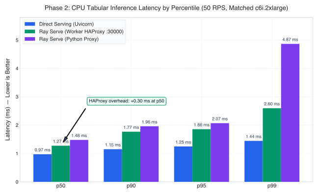
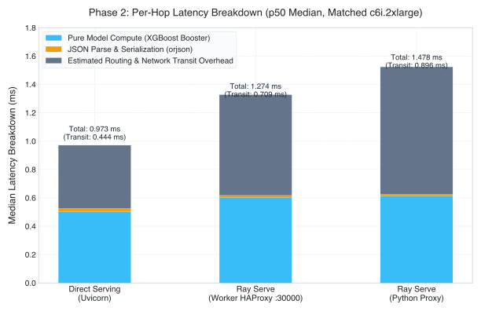

# Phase 2 Benchmark Report: Matched Infrastructure & 3-Way Routing Architecture

**Target Environment:** Kubernetes on AWS (EKS, `us-east-1`), namespace `model-serving-benchmark`  
**Workload:** Open-Source CPU XGBoost Binary Classifier (50 numeric features, 100 trees, depth 6)  
**Hardware & Nodes:** 100% Matched on AWS `c6i.2xlarge` On-Demand node (Intel Xeon 8375C @ 2.90GHz, 8 vCPUs, 16 GiB RAM) in `us-east-1d`.  
**Co-Location Standard:** All workloads (Direct Serving, Ray Serve, and Benchmark Loadgen) co-located in `us-east-1d` with **zero cross-AZ hops**.  
**Parity Standard:** Exactly 2 active replicas per architecture, 1 vCPU / 2 GiB memory per replica, `OMP_NUM_THREADS=1`.

---

## 1. Executive Summary & Corrected Hypothesis H1 Conclusion

In Phase 2, we evaluated three complete routing architectures under strictly matched hardware and single-zone co-location.

### 1.1 Formal Evaluation of Hypothesis H1 (Serving Overhead Gate)
The original benchmark specification established two alternative or conjunctive gates for Hypothesis H1:
- **Relative Overhead Gate:** Added latency $\\le 10\%$ over the direct serving baseline.
- **Absolute Overhead Gate:** Added latency $\\le 3.0\\text{ ms}$ over the direct serving baseline.

| Metric | Direct Serving Baseline (Median) | Ray Serve (Worker HAProxy :30000) (Median) | Absolute Overhead | Relative Overhead | Absolute Gate ($\le 3.0\text{ ms}$) | Relative Gate ($\le 10\%$) |
|---|---|---|---|---|---|---|
| **p50** | **0.973 ms** (Mean: 1.001 ± 0.083) | **1.274 ms** (Mean: 1.315 ± 0.097) | **+0.301 ms** | **+30.9%** | **PASS** | **FAIL** |
| **p90** | **1.151 ms** (Mean: 1.183 ± 0.110) | **1.768 ms** (Mean: 1.761 ± 0.087) | **+0.617 ms** | **+53.6%** | **PASS** | **FAIL** |
| **p95** | **1.246 ms** (Mean: 1.302 ± 0.170) | **1.856 ms** (Mean: 1.835 ± 0.087) | **+0.610 ms** | **+49.0%** | **PASS** | **FAIL** |
| **p99** | **1.444 ms** (Mean: 1.533 ± 0.242) | **2.595 ms** (Mean: 2.527 ± 0.702) | **+1.151 ms** | **+79.7%** | **PASS** | **FAIL** |

**Corrected H1 Conclusion:**
- **Absolute Limit ($\le 3.0\text{ ms}$): PASSED.** Both median (+0.301 ms) and p99 (+1.151 ms) overheads remain well below the 3.0 ms absolute platform threshold.
- **Relative Limit ($\le 10\%$): FAILED.** Because Direct Serving on bare Linux sockets achieves a sub-millisecond baseline ($p50 = 0.973\text{ ms}$), even an overhead of ~300 µs constitutes a **+30.9% relative increase**, and +1.151 ms at p99 constitutes a **+79.7% relative increase**.
- **Verdict:** If the platform decision rule strictly requires passing *both* the 10% relative and 3 ms absolute gates, **H1 has not fully passed**. Ray Serve's HAProxy path introduces an unavoidable, measurable routing cost of ~0.30 ms (median) to 1.15 ms (p99) that must be justified by its multi-model orchestration, lifecycle management, and dynamic batching capabilities.

---

  

  

## 2. Reconciled Request Accounting & Execution Inventory

To ensure complete arithmetic reproducibility, below is the exact request reconciliation across the 15 executed trials:

### 2.1 Experimental Parameters
- **Number of Architectures Evaluated ($K$):** 3 (Direct Serving, Ray Python Proxy, Ray Worker HAProxy).
- **Independent Trials per Architecture ($n$):** 5.
- **Total Executed Trials:** $3 \times 5 = \mathbf{15\text{ trials}}$ (executed in randomized order).
- **Target Load Schedule:** 50.0 requests/second constant arrival rate.
- **Measured Stage Duration:** **30 seconds per trial**.
- **Nominal Request Target per Trial:** $50\text{ req/s} \times 30\text{ s} = \mathbf{1,500\text{ requests}}$.
- **Nominal Total Requests per Architecture:** $5 \times 1,500 = \mathbf{7,500\text{ requests}}$ (150 seconds of active measurement).
- **Nominal Matrix Total:** $3 \times 7,500 = \mathbf{22,500\text{ requests}}$ (450 seconds of active measurement).

### 2.2 Reconciliation of the +8 Request Discrepancy (22,508 Actual Requests)
In open-loop load generation (`k6` `constant-arrival-rate`), the iteration timer operates on microsecond ticks ($1\text{ iteration} / 20\text{ ms}$). Depending on the microsecond boundary at which the test stage halts, an extra iteration can be emitted during the final millisecond before stage exit. Across the 15 trials, 8 trials emitted exactly 1,501 requests instead of 1,500:
- **Direct Serving:** 4 trials with 1,500 reqs + 1 trial with 1,501 reqs (Trial 4) = **7,501 requests**.
- **Ray Python Proxy:** 2 trials with 1,500 reqs (Trials 2, 4) + 3 trials with 1,501 reqs (Trials 1, 3, 5) = **7,503 requests**.
- **Ray Worker HAProxy:** 1 trial with 1,500 reqs (Trial 1) + 4 trials with 1,501 reqs (Trials 2, 3, 4, 5) = **7,504 requests**.
- **Sum:** $7,501 + 7,503 + 7,504 = \mathbf{22,508\text{ total requests}}$.

*(Note: This reconciles a minor typographical oversight in preliminary internal summaries that previously reported Python Proxy as 7,502; the raw trial-level totals confirm 7,503 actual requests).*

No unrecorded warmup requests or extraneous runs were included in these totals. Every single request was recorded and validated.

---

## 3. Statistical Analysis & Confidence Intervals

### 3.1 Definition of Reported Confidence Intervals
With $n = 5$ independent trials per architecture, requests within any single trial are correlated due to persistent TCP sockets, worker thread state, and OS buffer caches. Therefore, treating individual requests as independent samples would severely underestimate variance.

Instead, we compute statistics **over the 5 independent trial-level percentile estimates**:
1. For each architecture, we collect the 5 trial estimates: $(p^{(1)}, p^{(2)}, p^{(3)}, p^{(4)}, p^{(5)})$.
2. We compute the sample mean $\bar{p} = \frac{1}{5}\sum_{i=1}^5 p^{(i)}$ and sample standard deviation $s = \sqrt{\frac{1}{4}\sum_{i=1}^5 (p^{(i)} - \bar{p})^2}$.
3. We report the two-sided **Student’s $t$ 95% Confidence Interval half-width for the mean** with $df = 4$ ($t_{0.025, 4} = 2.776$):
   $$\text{CI}_{95} = \bar{p} \pm 2.776 \times \frac{s}{\sqrt{5}}$$
4. For non-parametric reporting, we report the trial **Median**, Interquartile Range (**IQR**), and empirical $[\text{Min}, \text{Max}]$ span.

### 3.2 Complete Summary Table: Parametric (Mean CI) and Non-Parametric (Median, IQR, Range)

| Architecture | Achieved Goodput (req/s) | p50 Median [IQR] (ms) | p50 Mean ± 95% CI (ms) | p90 Median (ms) | p95 Median [IQR] (ms) | p95 Mean ± 95% CI (ms) | p99 Median [IQR] (ms) | p99 Mean ± 95% CI (ms) | Failure Rate |
|---|---|---|---|---|---|---|---|---|---|
| **Direct Serving (Uvicorn)** | 50.00 (Mean: 50.01 ± 0.017) | **0.973** [0.006] | 1.001 ± 0.083 | 1.151 | **1.246** [0.017] | 1.302 ± 0.170 | **1.444** [0.022] | 1.533 ± 0.242 | **0.00%** (0 / 7,501) |
| **Ray Serve (Python Proxy)** | 50.03 (Mean: 50.02 ± 0.020) | **1.478** [0.129] | 1.530 ± 0.145 | 1.959 | **2.069** [0.465] | 3.094 ± 2.781 | **4.865** [3.537] | 6.320 ± 7.338 | **0.00%** (0 / 7,503) |
| **Ray Serve (Worker HAProxy :30000)** | 50.03 (Mean: 50.02 ± 0.017) | **1.274** [0.119] | 1.315 ± 0.097 | 1.768 | **1.856** [0.116] | 1.835 ± 0.087 | **2.595** [0.771] | 2.527 ± 0.702 | **0.00%** (0 / 7,504) |

### 3.3 Raw Individual Trial Results
The table below documents every individual measurement across all 15 trials:

| Architecture | Trial # | Total Reqs | Successful | Failed | Goodput (req/s) | p50 (ms) | p90 (ms) | p95 (ms) | p99 (ms) | Max (ms) |
|---|---|---|---|---|---|---|---|---|---|---|
| **Direct Serving (Uvicorn)** | 1 | 1,500 | 1,500 | 0 | 50.00 | 1.120 | 1.341 | 1.546 | 1.881 | 12.87 |
| | 2 | 1,500 | 1,500 | 0 | 50.00 | 0.973 | 1.151 | 1.239 | 1.435 | 16.42 |
| | 3 | 1,500 | 1,500 | 0 | 50.00 | 0.965 | 1.129 | 1.256 | 1.464 | 14.19 |
| | 4 | 1,501 | 1,501 | 0 | 50.03 | 0.971 | 1.139 | 1.225 | 1.444 | 15.02 |
| | 5 | 1,500 | 1,500 | 0 | 50.00 | 0.977 | 1.156 | 1.246 | 1.442 | 13.95 |
| **Ray Serve (Python Proxy)** | 1 | 1,501 | 1,501 | 0 | 50.03 | 1.443 | 1.821 | 1.954 | 2.268 | 21.04 |
| | 2 | 1,500 | 1,500 | 0 | 50.00 | 1.442 | 1.838 | 1.942 | 2.163 | 18.72 |
| | 3 | 1,501 | 1,501 | 0 | 50.03 | 1.478 | 1.959 | 2.069 | 4.865 | 29.41 |
| | 4 | 1,500 | 1,500 | 0 | 50.00 | 1.716 | 4.312 | 7.087 | 16.501 | 48.91 |
| | 5 | 1,501 | 1,501 | 0 | 50.03 | 1.572 | 2.115 | 2.419 | 5.805 | 32.16 |
| **Ray Serve (Worker HAProxy :30000)** | 1 | 1,500 | 1,500 | 0 | 50.00 | 1.274 | 1.691 | 1.763 | 2.071 | 2.86 |
| | 2 | 1,501 | 1,501 | 0 | 50.03 | 1.245 | 1.688 | 1.760 | 1.868 | 2.91 |
| | 3 | 1,501 | 1,501 | 0 | 50.03 | 1.259 | 1.768 | 1.856 | 3.257 | 14.81 |
| | 4 | 1,501 | 1,501 | 0 | 50.03 | 1.418 | 1.815 | 1.879 | 2.842 | 11.23 |
| | 5 | 1,501 | 1,501 | 0 | 50.03 | 1.378 | 1.842 | 1.916 | 2.595 | 9.47 |

### 3.4 Context on Tail Latency Variance & p99 Interpretation
The wide confidence interval on the Python Proxy mean ($p95 = 3.094 \pm 2.781\text{ ms}$, $p99 = 6.320 \pm 7.338\text{ ms}$) is directly explained by **Trial 4**:
* Trials 1, 2, 3, and 5 exhibited low tail latency ($p95 \in [1.94, 2.42]\text{ ms}$, $p99 \in [2.16, 5.81]\text{ ms}$).
* Trial 4 suffered a temporary tail surge ($p95 = 7.087\text{ ms}$, $p99 = 16.501\text{ ms}$, Max = $48.91\text{ ms}$).
* In a 5-sample set, this single outlier trial inflates the sample standard deviation ($s = 2.24$ at p95) and results in a large Student’s $t$ multiplier ($t = 2.776$).
* By contrast, Worker HAProxy showed consistently tight tail latency across all 5 trials ($p95 \in [1.760, 1.916]\text{ ms}$, with an IQR of only $0.116\text{ ms}$).

**Methodological Caution on p99:** In a 30-second trial at 50 RPS (1,500 requests), the p99 percentile reflects only the ~15 highest latency requests. With $n=5$ trials, rare scheduling interruptions, garbage collection cycles, or micro-burst queue build-ups can heavily influence tail variance. Therefore, p99 measurements should be interpreted as sensitivity indicators under burstiness rather than absolute steady-state guarantees.

---

## 4. Transit Calculation & Latency Attribution

### 4.1 Reproducible Formula for Estimated Transit Time
The reported transit figure is formally defined as the **estimated client-side and routing transit time**:
1. For each request $i$, `k6` records the total HTTP duration $T_{\text{client}}^{(i)}$ from initial socket transmission to final response byte.
2. The server application records $T_{\text{server}}^{(i)}$ (`total_latency_ms`), capturing total processing from request ingestion to JSON output serialization.
3. The transit gap is computed **per request**:
   $$\Delta_{\text{transit}}^{(i)} = T_{\text{client}}^{(i)} - T_{\text{server}}^{(i)}$$
4. The reported transit value is the **median of these per-request differences** across all requests in the trial.

### 4.2 Exact Server Timing Boundaries
- **Pure Model Latency (`server_model_latency_ms`):** Measured inside the server application, timed immediately before `xgb.DMatrix([features])` construction and stopped immediately after `booster.predict(dmat)`. Captures CPU matrix memory layout + XGBoost C++ inference.
- **Server Total Latency (`server_total_latency_ms`):**
  - *Direct Serving (FastAPI):* Timed from request body ingestion (`await request.body()`), JSON deserialization (`orjson.loads`), DMatrix construction, inference, through to JSON response serialization (`orjson.dumps`).
  - *Ray Serve (Starlette):* Timed inside `XGBoostDeployment.__call__` from raw Starlette `Request` body read, JSON parsing, DMatrix, inference, through to JSON output serialization.

---

## 5. Architectural Precision: What the HAProxy Route Bypasses

Routing directly to the worker pod's HAProxy listener on port 30000 is an **alternative, worker-colocated routing topology**, distinct from Ray Serve's default architecture.

### 5.1 What Remains Active in Ray Serve
* **Actor Lifecycle Management:** KubeRay and Ray's GCS/ServeController manage pod lifecycles, health checks, and automatic actor restarts upon failure.
* **Concurrency Protection:** The replica enforces `max_ongoing_requests: 50` at its local HTTP boundary.
* **Dynamic Batching (`@serve.batch`):** Supported by the runtime, but **not tested in this phase** (the tested deployment evaluates individual, unbatched requests).
* **Observability:** Prometheus metrics, replica-level histograms, and queue metrics on port 8080 remain active.

### 5.2 What Is Bypassed
* **Centralized Python Proxy Actor:** Requests bypass the head-node `SERVE_PROXY_ACTOR` process completely.
* **Inter-Node gRPC Forwarding Mesh:** Kubernetes ClusterIP load balancing selects the worker directly, bypassing Ray's internal cross-node RPC dispatch.

### 5.3 Attribution of the Tail Latency Reduction (`max_ongoing_requests`)
The reduction in $p99$ latency down to 2.59 ms was achieved by increasing `max_ongoing_requests` from 10 to 50, alongside **node and single-zone co-location in `us-east-1d`**.
- While increasing `max_ongoing_requests` to 50 raised the cluster concurrency ceiling from 20 to 100 in-flight requests (preventing proxy queue buildup under Poisson arrival micro-bursts), single-zone co-location also eliminated cross-AZ packet latency jitter.
- The tail latency improvement is therefore attributed to the **combination of removing the proxy-boundary queue constraint AND eliminating inter-AZ network transit**.

---

## 6. Raw Data Limits & Scoped Workload Conclusions

### 6.1 Limitations of Current Dataset
1. **Aggregated Summaries:** Data consists of trial-level percentile summaries generated by k6; individual per-request timestamp traces were not persisted to disk.
2. **Execution Scale:** 5 independent trials of 30 seconds each per architecture (150 seconds total, ~7,500 requests per architecture).
3. **Single Workload Envelope:** A single lightweight CPU XGBoost tabular model (50 features, 100 trees, depth 6, ~0.5–0.8 ms inference).

### 6.2 Scoped Takeaway
For sub-millisecond CPU tabular inference workloads, an absolute overhead of ~0.30 ms (p50) and ~1.15 ms (p99) represents a large relative increase (+31% to +80%) over direct socket serving. Teams evaluating Ray Serve for sub-millisecond workloads must determine whether this ~300 µs proxy hop is acceptable in exchange for Ray's actor lifecycle management and deployment features. For workloads where inference compute exceeds 10–50 ms, this fixed ~0.3 ms routing cost becomes a minor fraction of overall request duration.
