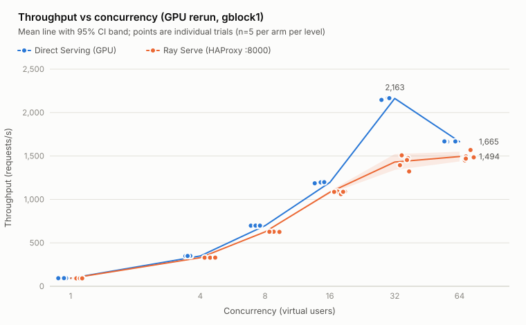
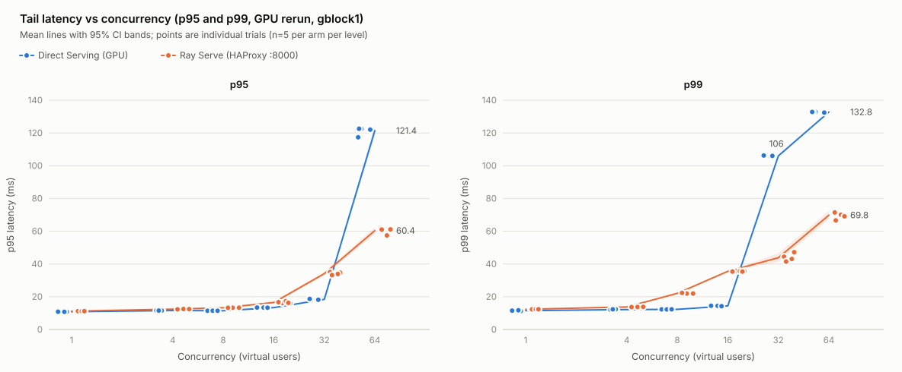

# Phase 3 GPU Rerun Report: Dynamic Micro-Batching on NVIDIA L4 (2026-11-19)

This rerun compares **Direct Serving (GPU)** (FastAPI + PyTorch with an asyncio micro-batching queue) against **Ray Serve (HAProxy :8000)** (`@serve.batch` behind Ray 2.60's HAProxy ingress), both serving `sentence-transformers/all-MiniLM-L6-v2` in FP16 on one NVIDIA L4 each. It ran 60 recorded trials: 2 arms × 6 closed-loop concurrency levels (C=1, 4, 8, 16, 32, 64) × 5 trials, 30 s each, in one block (`gblock1`). That is 1,683,922 requests with 0 failed.

All statistics below are quoted from the analyzer output, [`phase3-gpu-rerun-2026-11-19/summary.md`](phase3-gpu-rerun-2026-11-19/summary.md), produced by `results/analyze_gpu.py` from [`phase3-raw.json`](phase3-gpu-rerun-2026-11-19/phase3-raw.json). Nothing in this report was recomputed by hand.

## Verdicts at a glance

| Gate | Criterion | Verdict | Deciding numbers |
|---|---|---|---|
| **Low-Load Latency** | C=1 and C=4: Δp95 ≤ 3.0 ms or ≤ 10% | **PASS** | Δp95 +0.344 ms (+3.2%) at C=1; +0.874 ms (+7.6%) at C=4 |
| **Goodput** | Ray Serve ≥ 95% of Direct mean throughput at every level | **FAIL** | passes only at C=1 (98.39%); 94.37% at C=4, as low as 66.16% at C=32 |
| **Batch Scaling** | Ray Serve throughput(C=32) ≥ 3 × throughput(C=1) **and** p95(C=32) ≤ 20.0 ms | **FAIL** | scaling ×15.63 passes; p95 median 33.890 ms fails the 20 ms ceiling |
| **Saturation (C=64)** | Ray Serve p99 ≤ Direct p99 + 3.0 ms | **PASS** | Ray Serve p99 70.050 ms vs Direct 132.829 ms; Δp99 −62.779 ms |

The October snapshot left the C=64 saturation question **INCONCLUSIVE**, because it was measured before Direct's event-loop fix. This run settles it: **PASS**. With both arms fixed, Ray Serve's p99 at C=64 is 62.779 ms *below* Direct's (bootstrap 95% CI [−66.202, −60.983] ms). The gate allows up to +3.0 ms.

## 1. Stack, topology, and gate proof

**Stack.** Ray **2.60.0** (`rayproject/ray:2.60.0-py311-gpu` on the GPU worker), KubeRay operator **v1.7.2** (`preflight/kuberay-image.txt`), EKS **1.34**, NVIDIA device plugin **v0.17.1** on the GPU nodes only (`preflight/device-plugin.txt`), HAProxy **2.8.25** shipped in the Ray image. Direct runs `pytorch/pytorch:2.2.0-cuda12.1-cudnn8-runtime`. Ray Serve pins `torch==2.2.0` and `numpy<2` in its `runtime_env`.

**Topology.** Four nodes, all in `us-west-2a` (`preflight/nodes.txt`):

| Role | Instance | Hosts |
|---|---|---|
| head | `c6i.2xlarge` | KubeRay operator, Ray head |
| gpu1 | `g6.xlarge` (NVIDIA L4) | Direct Serving (GPU) pod |
| gpu2 | `g6.xlarge` (NVIDIA L4) | Ray GPU worker: one `EmbeddingDeployment` replica, HAProxy `:8000` |
| loadgen | `c6i.2xlarge` | k6 driver only |

**Request paths.** Direct: k6 → `direct-gpu-embed-svc:8000` → Uvicorn/FastAPI → asyncio batch queue → model. Ray Serve: k6 → `ray-ha-svc:8000` (selects the worker only) → **HAProxy `:8000`** → the replica's direct-ingress server (`:30001`) → `@serve.batch` → model.

**Gate proof.** The fail-closed preflight passed before any load ran (`preflight/gpu-preflight.log`, final line `[preflight:gpu] PASS`):

- **CUDA / L4:** both serving pods report `NVIDIA L4`. Direct was accepted through the application's own CUDA check. The Ray worker was accepted via `nvidia-smi` plus the app's readiness probe reporting `cuda=true`, because the gate found no torch-capable interpreter it could exec in that container. That is a weaker form of the design's `torch.cuda.is_available()` acceptance, and it is disclosed here as such.
- **HAProxy in the request path:** HAProxy request counters rose **170 → 190** across 10 `/embed` requests sent through `ray-ha-svc` (10/10 HTTP 200 with 384-dim embeddings). There are 2 ALIVE HAProxyManager actors (head + worker) and 0 non-fallback Python proxies. Ray 2.60's single head fallback proxy and one DEAD actor tombstone are tolerated and excluded by design. The worker listens on `:8000` (HAProxy) and `:30001` (replica direct ingress).
- **Live throughput env flags:** `RAY_SERVE_ENABLE_HA_PROXY=1` and `RAY_SERVE_THROUGHPUT_OPTIMIZED=1` were captured from the running head and worker containers, not just read from the manifest.
- **Serve config:** 1 RUNNING `EmbeddingDeployment` replica, `max_ongoing_requests: 1000` in `serveConfigV2`.
- **Cluster creation:** `preflight/cluster-create.log`.

**Teardown.** The cluster was deleted *before* this analysis was run. `preflight/teardown.log` ends with `2026-11-19 08:30:45 [✔]  all cluster resources were deleted`. The us-west-2 cluster lists taken before creation and after deletion (`preflight/us-west-2-clusters-before.json` / `-after.json`) are identical sets of 25 clusters, and neither contains `ray-serve-phase3-rerun`.

## 2. Per-arm × level results

Quoted from `summary.md` §1. Latency cells show median [IQR] / mean ± 95% CI (Student's t, df = 4). Goodput is the mean ± 95% CI of per-trial throughput. n = 5 at every cell.

| Arm | Level | p50 (ms) | p95 (ms) | p99 (ms) | Goodput (req/s) | Failed | Flags |
|---|---|---|---|---|---|---|---|
| **Direct Serving (GPU)** | C=1 | 10.317 [0.052] / 10.323 ± 0.074 | 10.851 [0.041] / 10.841 ± 0.054 | 11.507 [0.039] / 11.492 ± 0.229 | 93.02 ± 0.52 | 0 | — |
| **Direct Serving (GPU)** | C=4 | 10.997 [0.065] / 11.007 ± 0.052 | 11.552 [0.084] / 11.569 ± 0.059 | 12.101 [0.218] / 12.184 ± 0.177 | 349.00 ± 1.21 | 0 | — |
| **Direct Serving (GPU)** | C=8 | 10.824 [0.008] / 10.821 ± 0.019 | 11.441 [0.019] / 11.442 ± 0.021 | 12.284 [0.067] / 12.305 ± 0.149 | 698.32 ± 1.20 | 0 | — |
| **Direct Serving (GPU)** | C=16 | 12.411 [0.087] / 12.421 ± 0.102 | 13.366 [0.061] / 13.346 ± 0.058 | 14.428 [0.231] / 14.406 ± 0.197 | 1196.41 ± 10.66 | 0 | — |
| **Direct Serving (GPU)** | C=32 | 11.814 [0.175] / 11.819 ± 0.120 | 18.334 [0.419] / 18.403 ± 0.302 | 106.011 [0.599] / 105.995 ± 0.520 | 2162.53 ± 14.27 | 0 | — |
| **Direct Serving (GPU)** | C=64 | 34.531 [0.006] / 34.538 ± 0.042 | 122.541 [0.523] / 121.416 ± 2.822 | 132.829 [0.159] / 132.789 ± 0.286 | 1664.73 ± 4.49 | 0 | threshold ×5 |
| **Ray Serve (HAProxy :8000)** | C=1 | 10.406 [0.026] / 10.407 ± 0.023 | 11.195 [0.027] / 11.192 ± 0.025 | 12.330 [0.011] / 12.326 ± 0.016 | 91.52 ± 0.17 | 0 | — |
| **Ray Serve (HAProxy :8000)** | C=4 | 11.407 [0.003] / 11.404 ± 0.008 | 12.426 [0.145] / 12.430 ± 0.126 | 13.746 [0.133] / 13.773 ± 0.146 | 329.33 ± 0.40 | 0 | — |
| **Ray Serve (HAProxy :8000)** | C=8 | 11.672 [0.021] / 11.669 ± 0.022 | 13.266 [0.025] / 13.261 ± 0.026 | 21.957 [0.296] / 22.082 ± 0.255 | 626.68 ± 1.45 | 0 | — |
| **Ray Serve (HAProxy :8000)** | C=16 | 13.431 [0.040] / 13.502 ± 0.230 | 16.263 [0.572] / 16.478 ± 0.655 | 35.580 [0.231] / 35.508 ± 0.177 | 1083.25 ± 15.42 | 0 | — |
| **Ray Serve (HAProxy :8000)** | C=32 | 19.661 [0.515] / 20.336 ± 2.023 | 33.890 [1.032] / 34.105 ± 0.954 | 43.056 [1.528] / 43.820 ± 2.687 | 1430.80 ± 91.36 | 0 | threshold ×5 |
| **Ray Serve (HAProxy :8000)** | C=64 | 40.942 [0.755] / 39.960 ± 2.920 | 60.999 [0.635] / 60.367 ± 2.107 | 70.050 [2.338] / 69.816 ± 2.597 | 1493.79 ± 56.57 | 0 | threshold ×5 |

Rounded to whole requests per second, peak goodput is **2,163 req/s for Direct (C=32)** and **1,494 req/s for Ray Serve (C=64)**.

**Three cells to read carefully:**

- **Direct Serving (GPU) at C=32 has a heavy tail above p95.** p95 is about 18.4 ms, but p99 is about 106 ms in **all 5 trials** (105.5–106.6 ms). k6's p95 < 25 ms budget is never crossed, so these trials carry **no** threshold flag. The flag tracks p95 only and misses this tail. The p99 stays high across trials and does not average away. This run doesn't measure the cause. It fits about 1% of requests waiting behind a full batch as Direct reaches its throughput peak.
- **Ray Serve (HAProxy :8000) at C=32 is the loosest cell in the run.** Per-trial throughput ranges 1,322–1,508 req/s (about 13%), so the goodput CI is ±91.36. This fits C=32 being Ray Serve's threshold edge: it is the lowest level at which its p95 (about 34 ms) is past the 25 ms budget in every trial.
- **Direct throughput falls from C=32 to C=64** (2,162.53 → 1,664.73 req/s), while its p95 jumps to about 121 ms. Ray Serve's throughput rises slightly over the same step (1,430.80 → 1,493.79 req/s), with a much lower tail.

### Threshold-flagged trials (15 of 60) and hard failures (0)

k6 exits 99 when a trial crosses its thresholds (`http_req_failed` rate < 0.001, `http_req_duration` p(95) < 25 ms). The runner records such a trial with `threshold_breached=true` instead of aborting. **15 trials** carry the flag, and every one crossed the 25 ms p95 latency budget:

| Arm | Level | Flagged trials | p95 median (ms) |
|---|---|---|---|
| Direct Serving (GPU) | C=64 | 5 of 5 (trials 1–5) | 122.541 |
| Ray Serve (HAProxy :8000) | C=32 | 5 of 5 (trials 1–5) | 33.890 |
| Ray Serve (HAProxy :8000) | C=64 | 5 of 5 (trials 1–5) | 60.999 |

**There were 0 hard failures**: `failed_requests == 0` on all 60 trials (1,683,922 requests). The flag marks a busted latency budget. No request errored. All 15 flagged trials are kept in every statistic and gate.

## 3. Deltas (Ray Serve − Direct) with bootstrap CIs

Quoted from `summary.md` §2. Each delta is a median difference with a seeded percentile-bootstrap 95% CI (10,000 resamples, seed 42).

| Level | Δp50 (ms) | Δp95 (ms) | Δp99 (ms) |
|---|---|---|---|
| C=1 | +0.089 [+0.013, +0.175] | +0.344 [+0.298, +0.412] | +0.823 [+0.594, +1.112] |
| C=4 | +0.410 [+0.346, +0.443] | +0.874 [+0.739, +0.999] | +1.645 [+1.340, +1.844] |
| C=8 | +0.848 [+0.821, +0.875] | +1.825 [+1.789, +1.850] | +9.673 [+9.454, +10.074] |
| C=16 | +1.020 [+0.908, +1.419] | +2.897 [+2.649, +3.936] | +21.152 [+20.864, +21.350] |
| C=32 | +7.847 [+7.513, +11.403] | +15.556 [+14.871, +16.754] | −62.955 [−64.518, −58.795] |
| C=64 | +6.411 [+1.262, +6.793] | −61.542 [−65.099, −56.370] | −62.779 [−66.202, −60.983] |

No CI crosses zero. Up to C=16, Ray Serve adds latency at every percentile, and its p99 overhead grows quickly once batches start to fill (+9.7 ms at C=8, +21.2 ms at C=16). At C=32 the p99 sign flips, because Direct's tail breaks away (see §2). At C=64 the p95 sign flips too, as Direct saturates.

## 4. Gate verdicts

All four verdicts are quoted from `summary.md` §3.

### Gate 1: Low-Load Latency: PASS (absolute)

| Level | Direct p95 (median) | Ray Serve p95 (median) | Δp95 | Relative | Abs ≤ 3.0 ms | Rel ≤ 10% |
|---|---|---|---|---|---|---|
| C=1 | 10.851 ms | 11.195 ms | +0.344 ms | +3.2% | PASS | PASS |
| C=4 | 11.552 ms | 12.426 ms | +0.874 ms | +7.6% | PASS | PASS |

At low load, HAProxy ingress plus `@serve.batch` costs well under a millisecond at p95. The gate passes on both criteria.

### Gate 2: Goodput: FAIL

| Level | Ray Serve | Direct | Retention | Verdict |
|---|---|---|---|---|
| C=1 | 91.52 req/s | 93.02 req/s | 98.39% | PASS |
| C=4 | 329.33 req/s | 349.00 req/s | 94.37% | FAIL |
| C=8 | 626.68 req/s | 698.32 req/s | 89.74% | FAIL |
| C=16 | 1083.25 req/s | 1196.41 req/s | 90.54% | FAIL |
| C=32 | 1430.80 req/s | 2162.53 req/s | 66.16% | FAIL |
| C=64 | 1493.79 req/s | 1664.73 req/s | 89.73% | FAIL |

Ray Serve holds 95% of Direct's goodput only at C=1. C=4 misses by under a point. The worst gap is C=32, where Direct peaks and Ray Serve has already crossed its latency budget. In a closed loop, goodput is concurrency divided by latency, so this gate restates Ray Serve's higher per-request latency from C=4 through C=32.

### Gate 3: Batch Scaling: FAIL

- Ray Serve mean throughput: **91.52 req/s** at C=1 and **1430.80 req/s** at C=32, a ×15.63 scale-up (gate ≥ ×3). **PASS**.
- Ray Serve p95 median at C=32: **33.890 ms** (gate ≤ 20.0 ms). **FAIL**.

Dynamic batching works under Ray Serve (×15.63), but at C=32 the p95 is well past the 20 ms ceiling. For comparison, Direct's p95 median at C=32 is 18.334 ms (§2 table).

### Gate 4: Saturation (C=64): PASS

- Direct p99 median at C=64: **132.829 ms**
- Ray Serve p99 median at C=64: **70.050 ms**
- Δp99 (Ray Serve − Direct): **−62.779 ms**, bootstrap 95% CI [−66.202, −60.983] (gate ≤ +3.0 ms). **PASS**.

This replaces the October snapshot's **INCONCLUSIVE** C=64 verdict. October's single run had Ray Serve's p99 well below Direct's, but Direct's event loop was then blocked by synchronous `model.encode`, so the comparison could not be trusted. Both arms now offload encoding with `asyncio.to_thread`, and the result is still decisive. Under closed-loop saturation, Ray Serve holds a tail about half of Direct's. It also delivers 89.73% of Direct's throughput at this level (Gate 2).

## 5. Charts

Generated by [`benchmarks/phase3-gpu-rerun/make_charts.py`](../benchmarks/phase3-gpu-rerun/make_charts.py) from `phase3-raw.json`. Both are static SVGs with light and dark variants that follow the viewer's color scheme. Each shows a mean line, a 95% CI band (t, df = 4), and every individual trial as a dot.

  

  

## 6. Disclosures

- **Per-trial counts:** 5 recorded trials per (arm × level), 60 in total, each 30 s, closed-loop (`constant-vus`) at fixed concurrency. Each (arm × level) had one unrecorded 15 s warmup before its trials. CIs are computed on n = 5 and should be read with that in mind.
- **Scope:** one small model (`all-MiniLM-L6-v2`, 22M parameters, FP16, 384-dim) on one GPU type (one NVIDIA L4 per arm, one replica per arm). Do not generalize to larger models, multi-GPU, or multi-replica deployments.
- **Untuned batching:** both arms use `max_batch_size=32` and `batch_wait_timeout_s=5 ms` (0.005). Ray Serve runs `max_concurrent_batches=1` (serial batches). These are fixed baseline settings and were **not** tuned for either arm. A shorter wait or concurrent batches could change the C=4–C=32 results.
- **`max_ongoing_requests: 1000`** on the Ray deployment, in both the decorator and `serveConfigV2`, so Serve admission control does not cap the closed-loop offer.
- **Baseline framing:** Direct Serving (GPU) is a custom Python asyncio queue (`asyncio.Queue` background worker, encode offloaded via `asyncio.to_thread`), not an industrial inference server such as Triton or TorchServe. The comparison is Ray Serve versus this hand-built FastAPI/PyTorch baseline.
- **Fixes since the October snapshot, applied to both arms:** model encoding is offloaded from the event loop with `asyncio.to_thread` in both Direct and Ray Serve. Ray Serve's measured path is now HAProxy `:8000` (October measured direct ingress `:30000`). Both pin `torch==2.2.0`. Ray Serve also pins `numpy<2` for torch ABI compatibility. Direct's image already ships numpy 1.x.
- **Node isolation:** separation is by instance type and role only. Each arm had its own `g6.xlarge` (Direct on gpu1, the Ray worker on gpu2), with a separate `c6i.2xlarge` head and a separate `c6i.2xlarge` load generator, all in `us-west-2a`. The two GPU nodes are distinct machines, so per-host variance is not separated from the arm effect. Nodes were not otherwise isolated (no dedicated tenancy, no CPU pinning).
- **Seed and run order:** every trial uses seed 42. The (arm, level, trial) queue was shuffled with that seed, under the constraint that each (arm, level) warmup precedes its trials, with a 3 s inter-trial cooldown. The as-run order is printed at the top of [`run-logs/gblock1-run.log`](phase3-gpu-rerun-2026-11-19/run-logs/gblock1-run.log). Trials ran 07:16:50–07:52:44 UTC on 2026-11-19.
- **Threshold flags:** 15 trials carry `threshold_breached=true` (§2). All are p95 latency-budget breaches, none are errors, and all are included in the statistics.
- **Not decomposed:** `summary.md` does not report server-side batch time or the network-transit split. The raw per-trial fields (`server_model_p50_ms`, `server_total_p50_ms`, `network_transit_p50_ms`) are in `phase3-raw.json`. Their timer boundaries differ between arms (Ray's server timer brackets `await self.batched_encode()`, including the batch wait), so they are not compared here.
- **CUDA acceptance on the Ray worker** used `nvidia-smi` plus app readiness rather than an in-container torch check (§1).

## 7. Provenance

The October snapshot (`results/phase3-gpu-embeddings-report.md`, `results/gpu_embed/`) is retained unchanged for provenance.
